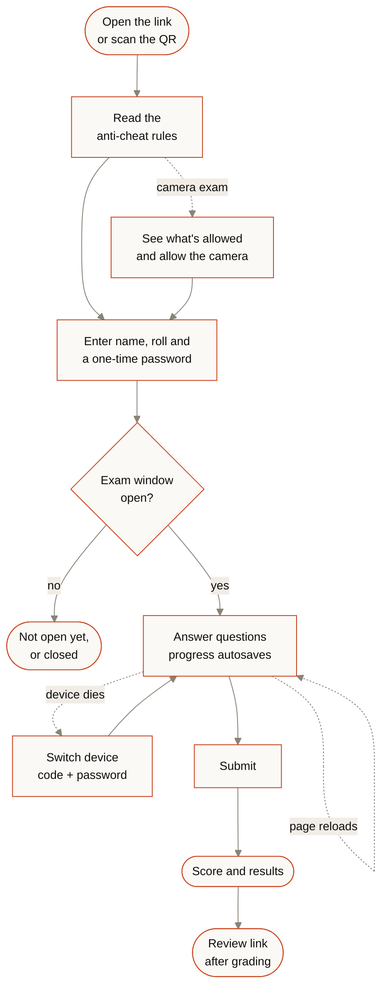
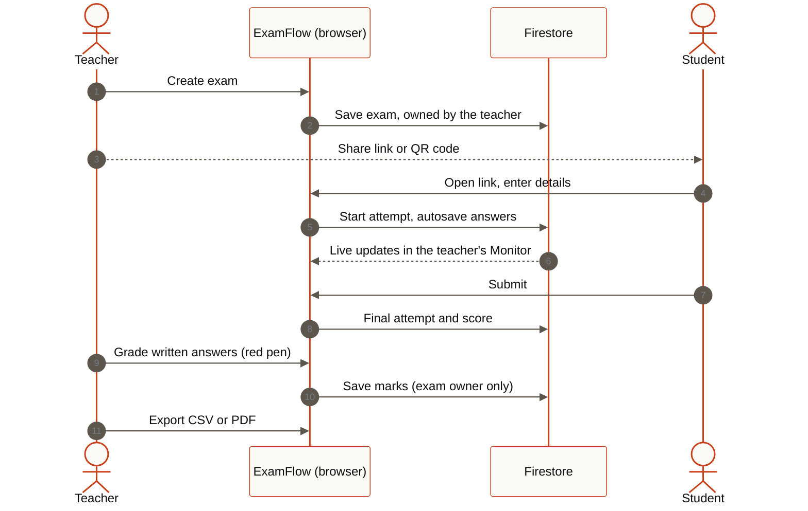
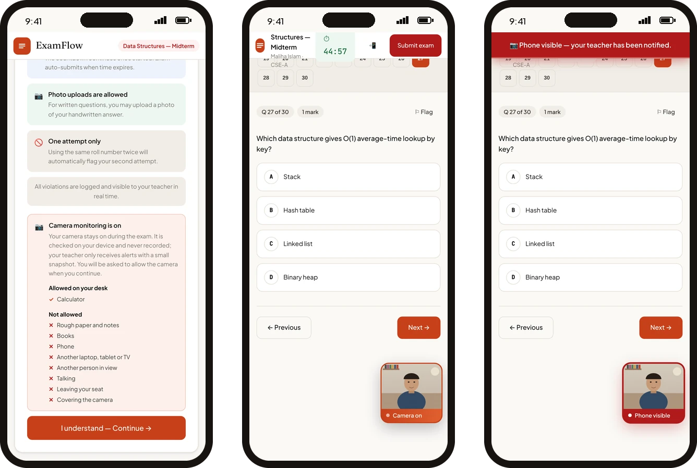
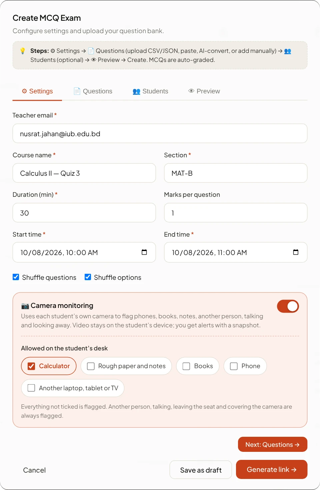
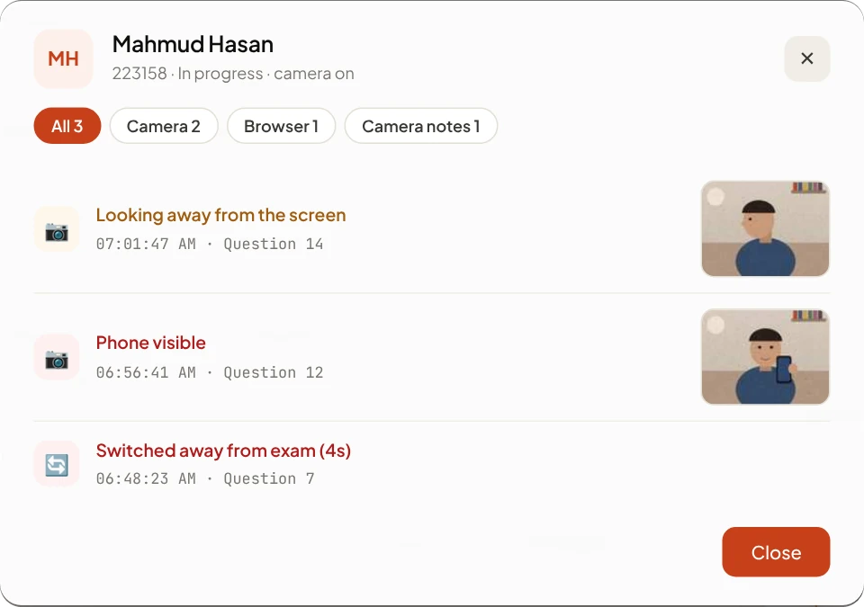
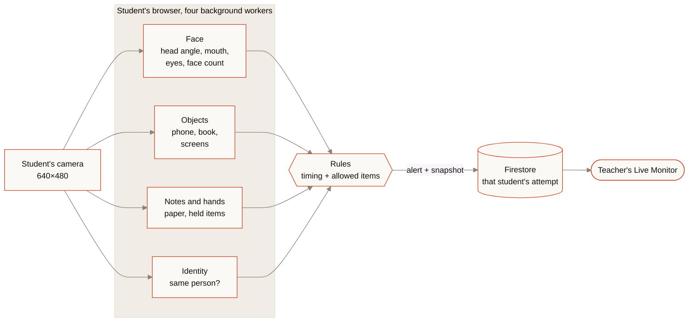
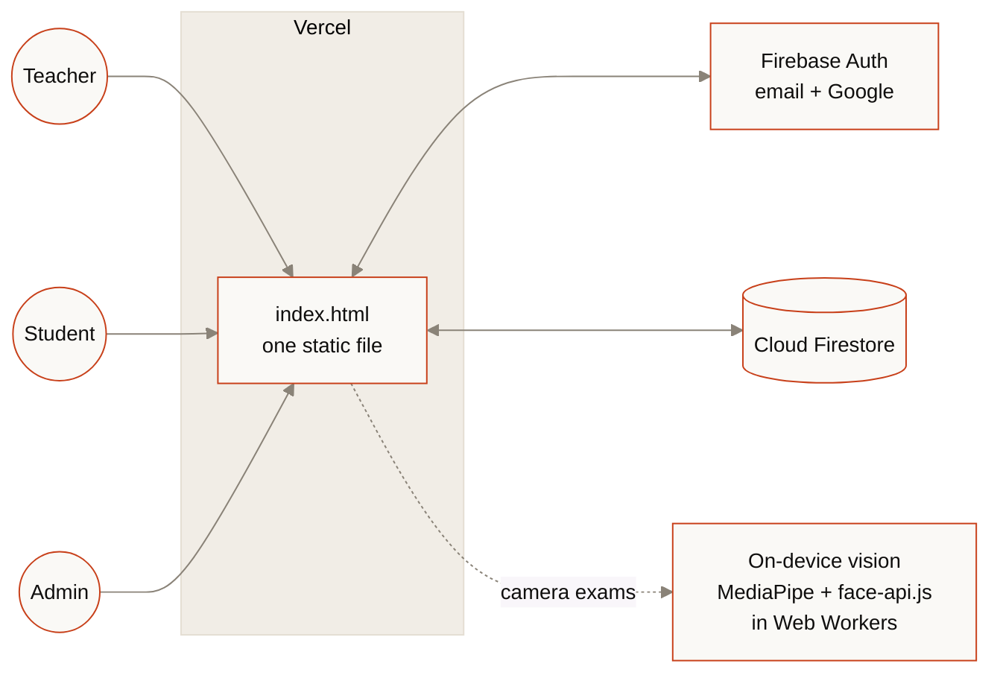

<div align="center">

<a href="https://examflow-tahcreations.vercel.app"></a>

<p>
<a href="https://examflow-tahcreations.vercel.app"></a>

<a href="docs/institutions.md"></a>
<a href="docs/paper-reader.md"></a>
<a href="#camera-monitoring"></a>


</p>

**Browser-based exams for teachers.** Build an MCQ, written or combined exam, share one link,<br>watch the class live, even through each student's own camera, grade and export.<br>Students never need an account.

<a href="https://examflow-tahcreations.vercel.app"><b>Open the live site</b></a>
&nbsp;·&nbsp; <a href="#how-an-exam-flows">How it works</a>
&nbsp;·&nbsp; <a href="#camera-monitoring">Camera</a>
&nbsp;·&nbsp; <a href="docs/paper-reader.md">Paper reader</a>
&nbsp;·&nbsp; <a href="#a-look-inside">Screens</a>
&nbsp;·&nbsp; <a href="#features">Features</a>
&nbsp;·&nbsp; <a href="#admin-monitor">Admin</a>
&nbsp;·&nbsp; <a href="#institutions">Institutions</a>
&nbsp;·&nbsp; <a href="#run-your-own-copy">Run your own</a>
&nbsp;·&nbsp; <a href="#faq">FAQ</a>
&nbsp;·&nbsp; <a href="CHANGELOG.md">Changelog</a>

</div>

<br>

## How an exam flows


<details>
<summary><b>The student's side, step by step</b></summary>
<br>



- **Reloads are safe.** The student comes back to the same questions in the same shuffled order, with their answers and name intact, and the clock keeps running from the original start.
- **One attempt per browser,** and no new starts once the window has closed.
- **Camera exams** ask for the camera before the details form, so permission prompts never eat exam time.

</details>

<details>
<summary><b>What happens behind the scenes during a live exam</b></summary>
<br>



</details>

<br>

## Camera monitoring



Turn it on for any exam and ExamFlow uses **each student's own camera** to flag a phone, a book or notes, another person, talking, looking away or down, and a different person sitting down. You choose what's allowed on the desk, such as a calculator or rough paper. Everything is checked **on the student's device**: video is never uploaded or recorded, and you get each alert with a small snapshot, filed under that student's name.


<p align="center"><sub><b>The student's side.</b> The rules list what's allowed and what isn't, the camera turns on before the details form, and a small preview stays in the corner. It turns amber with <i>Look at the screen</i> before any alert, and red when one is sent.</sub></p>

<table>
<tr>
<td width="50%" valign="top" align="center"><br><sub><b>One switch when you create the exam.</b> Tick what's allowed on the desk; everything else is flagged. Also in Edit exam and the Live Monitor.</sub></td>
<td width="50%" valign="top" align="center"><br><sub><b>Violations per student.</b> Click a student's <b>violations</b> button to see only theirs, newest first, with the snapshot, time and question.</sub></td>
</tr>
</table>

<details>
<summary><b>Everything it flags</b></summary>
<br>

| Alert | When | Severity |
|---|---|---|
| No one at the screen | No face and no person for 1.5 s | High |
| Face not visible | Face hidden for 1.5 s (4 s if paper or a calculator is allowed) | Medium |
| More than one person | A second face, or a second body that stays | High |
| Different person in front of the camera | The face no longer matches the one seen at the start | High |
| Phone visible | A phone in view or in hand | High |
| Calculator visible | Only when calculators aren't allowed | High |
| Handheld device, could be a phone | An unclear device while calculators are allowed | Medium |
| Book visible · Notes or paper visible | A book, or paper with writing on it | High |
| Holding something up to the camera | A hand holding anything that isn't allowed | High |
| Another screen visible | A laptop, tablet or TV that wasn't there at the start | Medium |
| Looking away from the screen | Head turned 20° or more for 1.5 s | Medium |
| Repeated head turning | 3 turns within 30 s | Medium |
| Looking down, away from the screen | 2 s, unless paper or a calculator is allowed | Medium |
| Repeated talking | 3 times within 60 s | Medium |
| Camera covered or too dark · Camera stopped | The picture goes dark or the camera ends | High |
| Blocked camera access · No camera available | At the start of the exam | High · Medium |

High and medium alerts go into the student's violation log exactly like a tab switch: they flag the student, count in **Most violations**, and appear in the CSV export. Minor moments, like talking once, are kept as snapshots under **Camera notes**.

</details>

<details>
<summary><b>What teachers can allow</b></summary>
<br>

| Allowed item | Effect |
|---|---|
| Calculator | No alert for a calculator. A device that might be a phone is still flagged. |
| Rough paper and notes | No alert for paper or notes, and looking down is fine. |
| Books | No alert for books (open-book exam). |
| Phone | No alert for phones. |
| Another laptop, tablet or TV | No alert for extra screens. |

- **Always flagged:** another person, talking, leaving the seat, covering the camera.
- **Written answers:** in written exams, and the written part of a combined exam, paper is always allowed, because students photograph their handwritten work.
- **Live changes:** change the rules in the Live Monitor and students already in the exam are told within a second.

</details>

<details>
<summary><b>How it works</b></summary>
<br>



- **Models:** MediaPipe Face Landmarker, EfficientDet-Lite0 object detection, Hand Landmarker and an image classifier (phone vs calculator), plus face-api.js for the same-person check. All open source and free; they load from public CDNs only for camera exams.
- **Smooth on any device:** detection runs in four Web Workers at the same time, so the exam page never waits for it and no check waits for another. Each model uses the GPU or the CPU, whichever is faster on that device; a GPU that finds nothing or runs slow on the first real camera frames is swapped for the CPU. The check rate adapts to the device.
- **Calibration:** the first 2 seconds learn the student's straight-ahead position, closed mouth, face and empty background, so posters, a bookshelf or a TV behind them aren't flagged. If no face is seen in 8 seconds, monitoring starts anyway and learns once the face appears.
- **Data:** students download about 30 MB of models once; the browser caches it.

</details>

<br>

## A look inside


<p align="center"><sub><b>Teacher dashboard.</b> Every exam at a glance: status, window, questions, students, and one-click link, monitor, preview and exports.</sub></p>


<p align="center"><sub><b>Live monitor.</b> Progress per student, camera monitoring controls, flags and a score distribution, updating in real time. Each student's violations open in their own window.</sub></p>

<table>
<tr>
<td width="50%" valign="top" align="center"><br><sub><b>Red-pen grading.</b> Mark photographed handwritten answers right on the script.</sub></td>
<td width="50%" valign="top" align="center"><br><sub><b>One link, one QR.</b> Post it in WhatsApp, Google Classroom or email.</sub></td>
</tr>
</table>


<p align="center"><sub><b>The student's phone.</b> Anti-cheat rules, then their details, then the exam, with a question map, timer and flags.</sub></p>


<p align="center"><sub><b>The front door.</b> Teachers sign up with email or Google and create their first exam.</sub></p>

<br>

## Features

<table>
<tr>
<td width="33%" valign="top">

**Build**

MCQ, written, or combined exams. Drop a photo, PDF, Word, CSV or JSON file into one upload box: ExamFlow reads the questions, options, answers and diagrams itself, in your browser. Written papers come in with their parts (a)/(b) or ক/খ/গ, each part's printed marks, tables and page numbers, and printed solutions left out. A maths &amp; science keyboard and a drawing pad for diagrams. Set marks per MCQ, a duration, and an opening and closing time.

</td>
<td width="33%" valign="top">

**Share**

One link and a QR code per exam. Optional student list, so students pick their name instead of typing it. Questions and options can shuffle per student.

</td>
<td width="33%" valign="top">

**Watch**

A live monitor with progress, submissions and flags. Every student's violations open in their own window. Search, filter, sort, and see the score distribution form.

</td>
</tr>
<tr>
<td width="33%" valign="top">

**Protect**

Leaving full screen, switching tabs, copy/paste, right-click, blocked shortcuts, screenshot keys and leaving the page are all logged, per student, with a timestamp.

</td>
<td width="33%" valign="top">

**Grade**

MCQs mark themselves. Written answers get a red-pen layer on photos. Combined exams keep the MCQ marks in the total.

</td>
<td width="33%" valign="top">

**Export**

Results as CSV, answer scripts as PDF, and a private review link where each student sees only their own graded script.

</td>
</tr>
<tr>
<td width="33%" valign="top">

**See** <sup>new</sup>

Optional camera monitoring through each student's own camera: phones, books, notes, another person, talking, looking away.

</td>
<td width="33%" valign="top">

**Allow** <sup>new</sup>

Tick what's fine on the desk (calculator, rough paper, books, phone, another screen). Everything else is flagged.

</td>
<td width="33%" valign="top">

**Review** <sup>new</sup>

Camera alerts arrive with a small snapshot, the time and the question, filed under each student. Video never leaves their device.

</td>
</tr>
</table>

<details>
<summary><b>Everything teachers get</b></summary>
<br>

- **Three exam types:** MCQ, written, and combined (an MCQ section, then a timed written section). Either section of a combined exam can be left empty.
- **Scheduling:** an opening time, a closing time (which must come after the opening time) and a duration, or no timer at all. Ended exams can be reopened with a new window.
- **Drafts, live edits and sections:** save drafts, edit a live exam (students get the change instantly), group exams into sections, and restore deleted exams from the trash.
- **Camera monitoring:** one switch in Create exam, Edit exam and the Live Monitor, with allowed items. See [Camera monitoring](#camera-monitoring).
- **Violations per student:** each student's violations button opens a window with only theirs (browser and camera, with snapshots); the sidebar lists **Flagged students**.
- **Grading safety:** if saving marks fails, you're told instead of seeing "Marks saved".
- **Safe exports:** in CSV exports, spreadsheet formulas typed into student names are neutralised.
- **Paper reader:** drop phone photos, scanned or typed PDFs, or Word files (`.doc`, `.docx`). Questions, options, the answer (from a key, a circled or ticked letter, bold or shaded options, or an "Ans:" line) and diagrams are read in the browser; nothing is uploaded and no AI service is used. You check every question before it is added. See [docs/paper-reader.md](docs/paper-reader.md).
- **Question pictures:** upload, photograph, paste or draw a diagram for any question.
- **Maths &amp; science keyboard:** fractions, powers, roots, integrals, matrices, Greek letters, chemistry and Bangla digits, with a live preview.
- **Guides for every feature:** a searchable library for teachers and students, opened from the landing page, the avatar menu, and the ❔ buttons beside the camera switch, the upload box and the keyboard. Plus an in-app feedback form.

</details>

<details>
<summary><b>Everything students get</b></summary>
<br>

- **No account, no install.** Open the link, read the rules, enter your details, start.
- **Safe to refresh.** Same questions, same shuffled order, answers, name and roll kept, and the clock keeps its original start, so a reload can't reset the timer.
- **Device switching.** If a phone dies, **Switch device** resumes the same unsubmitted attempt elsewhere with a code and the student's one-time password.
- **Photo answers.** Handwritten work can be photographed for written questions. Photos are compressed in the browser (a 12-megapixel photo becomes roughly 100–250 KB) and each attempt holds about 700 KB of them. The first photos stay sharp, later ones get smaller, and the student is told when the limit is reached.
- **Camera exams, clearly explained.** The rules page says what's allowed and what isn't. If the camera is blocked or missing, the student is told how to fix it and can still continue (the teacher is notified). The preview can be dragged to any corner or tapped to shrink.
- **Clear outcomes.** One submission per browser, no new starts after the window closes, and if a submission can't reach the teacher, the student is told to keep the page open.

</details>

<br>

## Admin Monitor

For the owner only: sign in with the admin email, **examflow.live@gmail.com**, then avatar menu → **Admin Monitor**.


| Tab | What you see |
|---|---|
| **Overview** | Teachers, exams, attempts in progress, submissions, flags, feedback |
| **Teachers** | Every teacher's activity status, exams in the last 30 and 90 days, students, last activity, join date, and **View dashboard** |
| **Exams** | Every exam with its owner, status and attempts; open its sessions, the owner's dashboard, or delete it |
| **Live & sessions** | Every attempt across the platform |
| **Feedback** | The inbox from the in-app form |
| **🏛 Institutions** | Universities and schools that run ExamFlow on their own server: teacher lists, licences, packages, servers and the audit log ([below](#institutions)) |

**Status** is **Active** (used in the last 14 days), **Cooling** (15–30), **Dormant** (31–60), **Churned** (over 60) or **Never used**. **Drop-off** marks teachers who ran 3–6 exams and then went quiet for over 30 days, and sorts them to the top: the people worth asking why they stopped.

### View any teacher's dashboard


**View dashboard** opens a teacher's dashboard exactly as they see it: their exams, stats, sections and trash, and each exam's monitor with results, violation logs and written answers. The bar at the bottom shows whose dashboard is open; **Exit to Admin** takes you back.

<details>
<summary><b>How the read-only lock works</b></summary>
<br>

- **Disabled while viewing:** creating, editing, deleting, restoring, publishing, reopening and ending exams, saving marks, changing camera settings, adding sections, sending feedback and signing out.
- **Preview becomes a question sheet** with the correct answers ticked. A real preview runs an exam session that would write into their exam.
- **A safety net on the Firestore SDK** refuses every write while the view is open, even from a code path nobody remembered to guard.
- **Fresh data every time,** loaded with the same queries their own dashboard runs. Sections are rebuilt from their exams, because each teacher's sections are saved in their own browser.

</details>

<br>

## Institutions

Added in **v46**. A university or school can run ExamFlow on **its own server**, with every exam, attempt and mark stored in **its own database**. Individual teachers keep using the public site and your Firebase project exactly as before.

| | Where the data lives |
|---|---|
| Cloud teachers (the public site) | Your Firebase project, unchanged |
| An institution's teachers | The institution's server (SQLite, on its disk) |
| Institution administration (name, teacher IDs and emails, licence dates, packages, audit) | Your Firebase project, in `cp*` collections only the server functions can read |

From **Admin Monitor → 🏛 Institutions** you create an institution, import its teacher list (CSV `teacher_id,email`), set a licence (1, 2 or 4 months, 1 or 2 years, or custom), generate a signed package for its IT team, and renew, block or unblock it later. Every change asks for confirmation and is written to an audit log. An expired or blocked licence stops **new** exams only; nothing is deleted, and published exams, grading, results and exports keep working.

The package is a zip with a Docker setup (or plain Node.js 22), install guides and the teacher list, signed with your key. The institution's server checks in every few minutes with a signed request and receives a signed licence statement.

Full guide: **[docs/institutions.md](docs/institutions.md)**.

<br>

## Under the hood



- **One static file.** `index.html` holds all the markup, styles and scripts. No server of its own, no build step.
- **Firebase** (compat SDK 10.7.1): Authentication (email/password and Google, with a redirect on phones) and Cloud Firestore.
- **Libraries from CDNs:** GSAP 3.12.5 and three.js 0.160 for the landing page, plus libraries that load only when needed: jsPDF 2.5.1, qrcodejs 1.0.0, KaTeX 0.16.22 for typed maths; for the paper reader Tesseract.js 7.0.0, pdf.js 3.11.174, JSZip 3.10.1 and rtf.js 3.0.9; for camera exams MediaPipe Tasks Vision 0.10.14 and face-api.js 1.7.15.
- **Display scale:** on screens 1100 px and wider the site renders at 85%, like browser zoom at 85%; phones and tablets stay at 100%.
- **Hosting:** Vercel, as a static site.

<details>
<summary><b>Data model</b></summary>
<br>

| Collection | What it holds | Written by |
|---|---|---|
| `teachers/{uid}` | Teacher profile | The teacher, at sign-up |
| `exams/{token}` | Exam definition, keyed by its share token. Camera exams add `camMon` (on/off and allowed items) | The teacher who owns it |
| `sessions/{id}` | One student attempt. Camera exams add `CAMERA_*` violations, `camShots` (last 12 snapshots, 128×96) and `camStatus` | The student's browser; the owning teacher when grading |
| `feedback/{id}` | Feedback form entries | Anyone |
| `meta/stats` | Visit counter (no personal data) | Any visitor |

Exam sections live in each teacher's browser (localStorage). The browser cache never blocks the app: if it fills up, it's saved without photos (Firestore still has them) and exams keep working.

</details>

<details>
<summary><b>What's in this repository</b></summary>
<br>

| File | Purpose |
|---|---|
| `index.html` | The entire app, camera monitoring included |
| `robots.txt`, `sitemap.xml` | Search engine crawling for the live domain |
| `firestore.rules` | Cloud Firestore security rules |
| `database.rules.json` | Realtime Database rules; the app doesn't use it, so they deny everything |
| `firebase.json`, `.firebaserc` | Let the Firebase CLI deploy both rule files to project `examflow-195df` |
| `assets/` | The images and animations in this README |
| `tessdata/` | The Bangla + English and English reading models the paper reader uses |
| `docs/camera-monitoring.md` | Camera monitoring in depth: timings, data, tuning, troubleshooting |
| `docs/paper-reader.md` | The paper reader in depth: files, answer forms, how it reads photos, PDFs and Word files, limits |
| `CHANGELOG.md` | Version comparison and the reason for every change |

</details>

<details>
<summary><b>What it costs to run</b></summary>
<br>

| Piece | Cost |
|---|---|
| Vercel Hobby hosting | Free |
| Firebase Spark plan | Free. Past the daily limits (50,000 reads, 20,000 writes, 1 GB stored), requests pause until the next day instead of billing you |
| AI or paid APIs | None. ExamFlow calls no AI service and has no email or payment integration |
| Camera monitoring | Free. Open-source models (MediaPipe: Apache 2.0, face-api.js: MIT) run in each student's browser; there is no server, key or per-use fee |
| Paper reader | Free. Tesseract (Apache 2.0) and ExamFlow's own readers run in the teacher's browser; nothing is uploaded |

The biggest reader is the Admin Monitor, which reads every teacher, exam, attempt and feedback entry each time it opens. Camera monitoring adds only a few small writes per student: its status, its alerts and their snapshots.

</details>

<br>

## Run your own copy

1. **Create a Firebase project.** Enable Authentication → Sign-in method → **Email/Password** and **Google**. Create a **Cloud Firestore** database. Realtime Database isn't needed.
2. **Authorize your domain.** Authentication → Settings → Authorized domains → add the domain you'll host on, such as `your-app.vercel.app`. Google sign-in fails on unlisted domains.
3. **Point the app at your project.** In `index.html`, replace the config inside `firebase.initializeApp({...})` with your project's web config.
4. **Set the admin.** Change `const ADMIN_EMAILS` in `index.html` and `adminEmails()` in `firestore.rules`. They must match.
5. **Publish the rules** (below). Camera monitoring needs no rule changes.
6. **Deploy on Vercel.** Import this repository → framework preset **Other** → no build command → output directory is the repository root. Every push to `main` redeploys.
7. **Hosting elsewhere?** Update the domain in `index.html`, `robots.txt` and `sitemap.xml`. The camera needs HTTPS (or `localhost`).
8. **Institutions (optional).** Set `GHUM_SIGNING_PRIVATE_KEY` (from `node tools/make-signing-key.js`), `FIREBASE_SERVICE_ACCOUNT` and `PUBLIC_BASE_URL` in Vercel → Settings → Environment Variables, then redeploy. `package.json` installs `firebase-admin` for the two functions in `api/`; `vercel.json` ships the institution software with them. Without these, everything else works and the Institutions tab says it isn't set up. See [docs/institutions.md](docs/institutions.md#one-time-setup-on-vercel).

<details>
<summary><b>Publishing the security rules</b></summary>
<br>

**From the Firebase Console:** Firestore Database → **Rules** → paste `firestore.rules` → **Publish**. If the project has a Realtime Database, do the same with `database.rules.json` under Realtime Database → **Rules**.

**From the Firebase CLI:**

```bash
npm install -g firebase-tools
firebase login
firebase deploy --only firestore:rules,database
```

</details>

<br>

## Security

> [!NOTE]
> **Students never sign in.** Single-exam reads and the `sessions` collection stay open so signed-out browsers can take, resume and review exams. Listing exams is limited to each exam's owner and the admin.

> [!IMPORTANT]
> **Scores are calculated in the student's browser,** and the exam, answer key included, reaches that browser. There is no server to hide it behind, so a technically skilled student could tamper with their own attempt before submitting. Keep that in mind for high-stakes exams.

- **Submitted attempts are locked.** Only the teacher who owns the exam, or the admin, can change an attempt after it's submitted. Any other account, and any signed-out browser, is refused.
- **Teachers only touch their own data.** They can read, edit and delete their own exams, and can't hand an exam over to another account.
- **Student-supplied text is always shown as text.** Names, scores, violation labels, snapshots and photo data can't inject markup or scripts into the monitor, the violations window, the grading screen or the Admin Monitor.
- **The read-only teacher view is enforced in the app,** not in the rules; the rules keep the admin's delete powers.
- **Realtime Database is fully locked,** since nothing uses it.
- **Camera video stays on the student's device.** Frames are analysed in the browser and thrown away; only alerts and up to 12 small snapshots per attempt are saved.

> [!WARNING]
> **Camera snapshots are as readable as the rest of an attempt.** `sessions` is open to read (students need that to resume and review), so anyone who queries Firestore directly could read the small snapshots too. Students are told on the rules page; turn camera monitoring on only when you need it.

> [!TIP]
> **Admin rights come from one email,** set in `adminEmails()` and `ADMIN_EMAILS`. Keep that account's sign-in secure.

<br>

## FAQ

<details>
<summary><b>Do students need an account or an app?</b></summary>
<br>
No. They open the link or scan the QR code in any modern browser, on a phone or a computer.
</details>

<details>
<summary><b>Does ExamFlow use the camera to watch students?</b></summary>
<br>
Only if the teacher turns on <b>camera monitoring</b> for that exam; it's off by default. Students see the rules before they start, and the video is checked on their own device and never uploaded or recorded. The teacher receives alerts with a small snapshot. Without camera monitoring, anti-cheat is based on behaviour (full screen, tab switches, copy/paste, right-click, shortcuts, leaving the page), and the camera opens only when a student taps <b>Take photo</b> to attach handwritten work.
</details>

<details>
<summary><b>Can students use a calculator or rough paper in a camera exam?</b></summary>
<br>
Yes, if the teacher ticks it. Calculator, rough paper and notes, books, phone and another screen can each be allowed. Paper is always allowed while answering written questions.
</details>

<details>
<summary><b>What if a student has no camera, or blocks it?</b></summary>
<br>
They're told how to allow it. After a second refusal, or if there's no camera at all, they can continue the exam, and the teacher sees <i>Blocked camera access</i> or <i>No camera available</i> in that student's violations.
</details>

<details>
<summary><b>Will camera monitoring slow down a student's phone?</b></summary>
<br>
It runs in background workers so the exam stays responsive, picks the GPU or CPU per model (whichever is faster), and checks less often on slower devices. The models are about 30 MB, downloaded once and cached.
</details>

<details>
<summary><b>What if a student's phone reloads or dies mid-exam?</b></summary>
<br>
A reload brings them back to the same questions in the same order with their answers, and the timer keeps its original start. If the phone dies, <b>Switch device</b> resumes the same attempt on another device with a code and their one-time password.
</details>

<details>
<summary><b>How many photos can a student attach?</b></summary>
<br>
About 700 KB of photos per attempt, roughly 5–10 phone photos: the first ones stay sharp and later ones get smaller. An attempt is a single Firestore document, which caps at 1 MB.
</details>

<details>
<summary><b>Can a student change their score?</b></summary>
<br>
Not after submitting: only the exam's teacher or the admin can edit a submitted attempt. Before submitting, a technically skilled student could tamper with their own attempt, because scoring happens in the browser (see <a href="#security">Security</a>).
</details>

<details>
<summary><b>Does it cost anything?</b></summary>
<br>
Not on Vercel's Hobby plan and Firebase's Spark plan. There are no AI, email or payment services built in, and camera monitoring uses free, open-source models that run in the student's browser. See <b>What it costs to run</b> under <a href="#under-the-hood">Under the hood</a>.
</details>

<br>

---

<div align="center">

**ExamFlow v46** · Built by **GHUM** · Peace for you. No sleep for them. · <a href="mailto:examflow.live@gmail.com">examflow.live@gmail.com</a>

<sub>Full history and the reason behind every change: <a href="CHANGELOG.md">CHANGELOG.md</a></sub>

</div>
