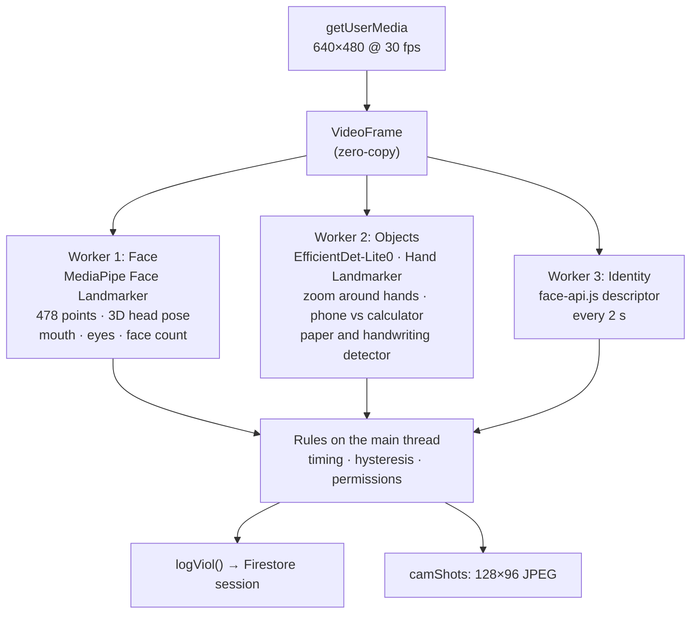

<div align="center">

# ExamFlow

**Browser-based exams for teachers. Build an MCQ, written or combined exam, share one link, watch students live, grade, and export.**
Students never need an account.

[](https://examflow-tahcreations.vercel.app)
[](CHANGELOG.md)
[](docs/camera-monitoring.md)


-0097A7)


**Built by [TahCreations](mailto:hellotahcreations@gmail.com)**

</div>

---

> [!IMPORTANT]
> **New in v39: camera monitoring.** Teachers can turn on each student's own camera for an exam. It flags phones, books, notes, another person, talking, head turning, looking away or down, and a different person taking over. Video is analysed on the student's device and never uploaded; the teacher gets alerts with a small snapshot, inside each student's own violations window. [Jump to the details ↓](#-camera-monitoring-new-in-v39)

## Contents

- [What's in this repository](#whats-in-this-repository)
- [📷 Camera monitoring (new in v39)](#-camera-monitoring-new-in-v39)
- [Features](#features)
- [How it's built](#how-its-built)
- [Run your own copy](#run-your-own-copy)
- [Publishing the security rules](#publishing-the-security-rules)
- [Security model](#security-model)
- [Changelog](#changelog)
- [Contact](#contact)

---

## What's in this repository

| File | Purpose |
|---|---|
| `index.html` | The entire app: markup, styles and scripts in one file. No build step. Includes the camera monitoring module. |
| `robots.txt`, `sitemap.xml` | Search-engine crawling and sitemap for the live domain. |
| `firestore.rules` | Cloud Firestore security rules. |
| `database.rules.json` | Realtime Database rules. The app doesn't use Realtime Database, so these deny everything. |
| `firebase.json`, `.firebaserc` | Let the Firebase CLI deploy both rule files to project `examflow-195df`. |
| `docs/camera-monitoring.md` | Full technical guide to the camera monitoring system. |
| `CHANGELOG.md` | Every version, what changed and why. |
| `.gitignore` | Keeps macOS, Firebase CLI and Vercel CLI files out of the repo. |

---

## 📷 Camera monitoring (new in v39)

### How a camera exam flows

```mermaid
flowchart LR
    A["👩‍🏫 Teacher creates exam<br/>Camera monitoring: ON<br/>ticks allowed items"] --> B["🔗 Shares one link"]
    B --> C["🧑‍🎓 Student opens link<br/>sees the rules:<br/>allowed / not allowed"]
    C --> D["📷 Allows camera<br/>(once, before details form)"]
    D --> E["⏱ Exam starts<br/>2-second calibration"]
    E --> F["🔍 Checks every frame<br/>on the student's device"]
    F -->|"violation"| G["⚠️ Banner for the student<br/>+ snapshot"]
    G --> H["☁️ Firebase<br/>(existing violation log)"]
    H --> I["📊 Live Monitor<br/>Student → violations window"]
```



### What it detects

| Check | Alert | Severity |
|---|---|---|
| No one in front of the camera | No one at the screen | 🔴 High |
| Face hidden or out of view | Face not visible | 🟠 Medium |
| A second face, or a second person in view | More than one person | 🔴 High |
| Someone else sits down | Different person in front of the camera | 🔴 High |
| Phone in view or in hand | Phone visible | 🔴 High |
| Calculator (when not allowed) | Calculator visible | 🔴 High |
| Device that might be a phone (when calculators are allowed) | Handheld device, could be a phone | 🟠 Medium |
| Book or notebook | Book visible | 🔴 High |
| Handwritten or printed notes, loose paper | Notes or paper visible | 🔴 High |
| Any object held up near the camera | Holding something up to the camera | 🔴 High |
| Another laptop, tablet or TV | Another screen visible | 🟠 Medium |
| Head turned away for 1.5 s | Looking away from the screen | 🟠 Medium |
| Three head turns within 30 s | Repeated head turning | 🟠 Medium |
| Looking down for 2 s (phone in lap) | Looking down, away from the screen | 🟠 Medium |
| Talking several times within 60 s | Repeated talking | 🟠 Medium |
| Camera covered or too dark | Camera covered or too dark | 🔴 High |
| Camera stopped or unplugged | Camera stopped | 🔴 High |
| Camera blocked or missing at start | Blocked camera access / No camera available | 🔴 / 🟠 |

High and medium alerts go into the student's violation log (and flag the student), exactly like a tab switch. Low-level notes, such as talking once or a few side glances, are kept as snapshots only, under **Camera notes**.

### Teacher controls

- **Create exam** (MCQ, Written, MCQ + Written) and **Edit exam** have a **📷 Camera monitoring** switch, off by default.
- When it's on, tick what students may keep on the desk:

  | Allowed item | Effect when ticked |
  |---|---|
  | Calculator | Calculators get no alert; a device that could be a phone still does. |
  | Rough paper and notes | Paper, notes and looking down are not flagged. |
  | Books | Books are not flagged (open-book exam). |
  | Phone | Phones are not flagged. |
  | Another laptop, tablet or TV | Extra screens are not flagged. |

- Another person, talking, leaving the seat and covering the camera are **always** flagged.
- In **written exams**, and in the written part of a combined exam, paper is always allowed, because students write answers on paper and upload a photo.
- The **Live Monitor** has the same switch and checkboxes. Changes reach students already in the exam instantly, with a short notice.

### Where the teacher sees violations

Violations are shown **per student**, never in one combined feed.

1. Live Monitor → the student's **violations** button (for example `3 violations ›`) in the results table, or their row in the **Flagged students** list.
2. A window opens with **only that student's** violations, newest first: what happened, the time, the question number, and the camera snapshot (tap to enlarge).
3. Tabs: **All**, **Camera**, **Browser** (tab switches, copy and paste and the other existing checks), and **Camera notes**.

<details>
<summary><b>What the student sees</b></summary>

<br>

- On **Read before you begin**, a camera box lists what's allowed and not allowed.
- Pressing **I understand** asks for the camera *before* the details form, so it never interrupts the timer. If access is blocked, the student is told how to fix it; after a second refusal, or if there's no camera, they can continue and the teacher is notified.
- During the exam, a small camera preview sits in a corner. Students can drag it to any corner, and tap to shrink it. It turns amber with **Look at the screen** before any alert is sent.
- Real alerts appear in the exam's existing red banner.

</details>

<details>
<summary><b>How it works under the hood</b></summary>

<br>



- All detection runs in **three Web Workers**, so the exam page stays smooth. On browsers without worker support it falls back to the main thread at a lower rate.
- Models start loading on **Read before you begin** and are warmed up once, so detection is ready when the exam starts.
- **Head pose** comes from MediaPipe's 3D face transform. It's calibrated for 2 seconds at the start and slowly follows posture changes, so leaning back is not a head turn.
- **Notes detection** learns the empty background during calibration (walls and posters are ignored), then looks for new bright, rectangular areas with writing in them.
- **Books on a shelf or a TV behind the student** that were visible during calibration are ignored unless the student touches them.
- **Phone vs calculator:** an image classifier plus a pattern check (one smooth screen vs a regular grid of keys).

Full details, thresholds and troubleshooting: [`docs/camera-monitoring.md`](docs/camera-monitoring.md).

</details>

<details>
<summary><b>Cost, privacy and data use</b></summary>

<br>

- **No paid APIs, no API keys, no servers.** Models are open source (MediaPipe: Apache 2.0, face-api.js: MIT) and load from public CDNs.
- **Video never leaves the student's device.** Only alerts and up to 12 small snapshots per attempt are saved.
- Students download about **30 MB of models once**; the browser caches them afterwards.
- Firebase usage per student is a handful of small writes, far inside the free tier for a typical class.

</details>

### Try it in 2 minutes

- [ ] Create a test exam with **Camera monitoring** on and **Calculator** allowed.
- [ ] Open the link on another device and allow the camera.
- [ ] Show a phone, hold up written notes, turn your head for 2 seconds, and bring a second person into view.
- [ ] Open the Live Monitor, click your test student's **violations** button and check each alert and snapshot.

---

## Features

### For teachers

- **Three exam types:** MCQ, written, and combined (an MCQ section followed by a timed written section). Either section of a combined exam may be left empty.
- **Camera monitoring** (optional, per exam) with allowed items. See [above](#-camera-monitoring-new-in-v39).
- **Questions your way:** add them by hand or import a CSV. A built-in prompt turns any question file into the right CSV format with ChatGPT.
- **Marks per MCQ:** set how many marks each MCQ is worth; scores and percentages use it.
- **Optional student list,** so students pick their name from a list instead of typing it. A name can only be used once per exam.
- **Scheduling:** every exam has an opening time, a closing time (which must be after the opening time) and a duration, or no timer at all. Ended exams can be reopened with a new window.
- **Drafts, edits and sections:** save drafts, edit a live exam at any time (students get the change instantly), group exams into sections, and restore deleted exams from the trash.
- **Share** with a link or a QR code.
- **Live monitor:** progress per student, submissions, flagged students, search, sort, filters, a score distribution, and a **per-student violations window** with camera snapshots.
- **Written grading** with a red-pen annotation layer on photographed answers. In a combined exam, the MCQ marks stay in the total when you grade the written part. If a save fails, you're told instead of seeing "Marks saved".
- **Exports:** results as CSV (spreadsheet formulas in student-typed names are neutralised), answers as PDF.
- **Review link:** after grading, each student can see only their own script by entering their roll number and the one-time password they set.
- Teacher and student manuals, plus an in-app feedback form.

### For students

- No account, no install. Open the link, read the exam rules, enter your details, start.
- **Anti-cheat monitoring:** leaving full screen, switching tabs or windows, copy, cut, paste, right-click, blocked shortcuts, screenshot attempts and leaving the page are all logged with a timestamp and shown to the teacher live.
- **Camera monitoring** when the teacher turns it on, with the rules shown before the exam starts.
- **Safe to refresh:** if the page reloads mid-exam, the student comes back to the same questions in the same (shuffled) order, with their answers, name and roll intact, and the clock keeps running from the original start, so a refresh can't reset the timer.
- **Device switching:** progress is saved as the student works. If a device fails, **Switch device** resumes the same unsubmitted attempt elsewhere with a code and the student's one-time password.
- **Photos of handwritten work** can be attached to written answers. Photos are compressed in the browser (a 12-megapixel phone photo becomes roughly 100–250 KB), and each attempt holds about 700 KB of photos: the first ones stay sharp, later ones get smaller, and the student is told when the limit is reached.
- One submission per browser, and no new starts after the exam window closes. If a submission can't reach the teacher, the student is told to keep the page open.

<details>
<summary><b>Admin Monitor (owner only)</b></summary>

<br>

Available from the avatar menu → **Admin Monitor** when signed in with the admin email.

- **Overview:** teachers, exams, attempts in progress, submissions, flags, feedback.
- **Teachers:** every teacher with institution, activity status, exams in the last 30 and 90 days, student count, last activity and join date.
  - Status: **Active** (used in the last 14 days), **Cooling** (15–30 days), **Dormant** (31–60), **Churned** (over 60), **Never used**.
  - **Drop-off** marks teachers who ran 3–6 exams and then went quiet for over 30 days. They're sorted to the top.
  - **View dashboard** opens that teacher's dashboard, read-only (see below).
- **Exams:** every exam with its owner, status and attempts. Open its sessions, open the owner's dashboard, or delete it.
- **Live & sessions** and the **Feedback** inbox.

#### Viewing a teacher's dashboard

1. Sign in to ExamFlow with the admin email.
2. Open the avatar menu → **Admin Monitor** → **Teachers**.
3. Click **View dashboard** on any teacher (or **Teacher dashboard** on a row in the Exams tab).

You see their dashboard as they see it: their exams, stats, sections and trash, and each exam's monitor with student results, violation logs and written answers. A bar at the bottom of the screen shows whose dashboard is open; **Exit to Admin** takes you back.

Nothing you do in that view can change their account. Creating, editing, deleting, restoring, publishing, reopening and ending exams are disabled, as are saving marks, changing camera settings, sending feedback and signing out. **Preview** becomes a read-only question sheet, because a real preview runs an exam session that would write into their exam.

How the lock works: every write path in the app checks whether a teacher view is open, and a safety net wraps the Firestore SDK so any write that slips past those checks is refused before it leaves the browser. The teacher's data is loaded fresh from Firestore each time, using the same queries their own dashboard runs. Sections are rebuilt from their exams, because each teacher's sections are saved in their own browser.

</details>

---

## How it's built

- **One static file.** `index.html` holds everything. There is no server of its own and no build step.
- **Firebase** (compat SDK 10.7.1): Authentication (email/password and Google; Google sign-in uses a redirect on phones) and Cloud Firestore.
- **Libraries from CDNs:** GSAP 3.12.5, three.js 0.160 (landing page animation), and libraries that load only when needed:
  - jsPDF 2.5.1 and qrcodejs 1.0.0
  - MediaPipe Tasks Vision 0.10.14 and face-api.js 1.7.15 (`@vladmandic/face-api`), only for camera exams
- **Hosting:** Vercel, as a static site.
- **SEO:** page title, description and keywords, inline favicon, Open Graph and Twitter cards, one connected JSON-LD graph (WebSite, WebPage, Organization, SoftwareApplication, FAQ), a `<noscript>` summary, `robots.txt` and `sitemap.xml`.

### Data

| Where | What it holds | Written by |
|---|---|---|
| `teachers/{uid}` | Teacher profile | The teacher, at sign-up |
| `exams/{token}` | Exam definition, keyed by its share token. Camera exams add `camMon`. | The teacher who owns it |
| `sessions/{id}` | One student attempt. Camera exams add `CAMERA_*` violations, `camShots` and `camStatus`. | The student's browser; the owning teacher when grading |
| `feedback/{id}` | Feedback form entries | Anyone |
| `meta/stats` | Visit counter (no personal data) | Any visitor |

<details>
<summary><b>Camera fields in detail</b></summary>

<br>

```js
// exams/{token}
camMon: {
  on: true,
  allow: { calculator: true, roughPaper: false, books: false, phone: false, screens: false }
}

// sessions/{id}
violations: [ { type: 'CAMERA_PHONE_VISIBLE', time: '2026-10-06T10:42:13.000Z', q: 4 }, ... ]
camShots:   [ { t: 1791283333000, l: 'Phone visible', s: 'high', img: 'data:image/jpeg;base64,...' } ]  // up to 12
camStatus:  { state: 'on', t: 1791283300000 }   // 'on' | 'denied' | 'unavailable' | 'off'
```

</details>

Exam sections are stored in each teacher's browser (localStorage), not in Firestore. The browser cache never blocks the app: if it fills up, the cache is saved without photos (Firestore still has them) and exams keep working.

---

## Run your own copy

1. **Create a Firebase project.** Enable Authentication → Sign-in method → **Email/Password** and **Google**. Create a **Cloud Firestore** database. (Realtime Database isn't needed.)
2. **Authorize your domain.** Authentication → Settings → Authorized domains → add the domain you'll host on (for example `your-app.vercel.app`). Google sign-in fails on domains that aren't listed.
3. **Point the app at your project.** In `index.html`, replace the config inside `firebase.initializeApp({...})` with your project's web config.
4. **Set the admin.** Change `const ADMIN_EMAILS` in `index.html` and `adminEmails()` in `firestore.rules`. They must match.
5. **Update the domain** in `index.html` (canonical URL, Open Graph, JSON-LD), `robots.txt` and `sitemap.xml` if you host somewhere else.
6. **Publish the rules** (next section).
7. **Deploy on Vercel.** Import this repository → Framework preset **Other** → no build command → output directory is the repository root. Every push to `main` redeploys.

> [!NOTE]
> The camera needs **HTTPS** (Vercel provides it) or `localhost`. It won't start from a `file://` page.

---

## Publishing the security rules

**Firebase Console (no install):**

- Firestore Database → **Rules** → replace everything with `firestore.rules` → **Publish**.
- Realtime Database → **Rules** → replace everything with `database.rules.json` → **Publish**. (Only if the project has a Realtime Database; it locks it.)

**Firebase CLI:**

```bash
npm install -g firebase-tools
firebase login
firebase deploy --only firestore:rules,database
```

> [!TIP]
> v39 needs **no rule changes**. The camera setting is an exam field written by its owner, and the camera alerts are attempt fields written before submission. Both are already covered. The rules file only gained comments describing the new fields.

---

## Security model

- **Students never sign in.** Single-exam reads and the `sessions` collection stay open so signed-out browsers can take, resume and review exams. Listing exams is limited to the owner and the admin.
- **Everything is computed in the student's browser,** including the MCQ score, and the exam document, answer key included, reaches that browser. There is no server to hide it behind; keep that in mind for high-stakes exams.
- **Submitted attempts are locked.** Once submitted, only the teacher who owns the exam or the admin can change an attempt. Any other account, and any signed-out browser, is refused.
- **Teachers only touch their own data:** they can read, edit and delete their own exams, and can't reassign an exam to another account.
- **Admin rights come from the email** in `adminEmails()`. Keep that account's sign-in secure.
- **Student-supplied text is always shown as text.** Names, scores, violation labels, snapshot data and photo data can't inject markup or scripts into the teacher's monitor, the grading screen, the violations window, or the Admin Monitor.
- **The read-only teacher view is enforced in the app,** not by the rules. The rules keep the admin's delete powers for the Admin Monitor.
- **Realtime Database is fully locked,** since nothing uses it.

> [!WARNING]
> **Camera snapshots follow the same open-read rule as the rest of an attempt.** Anyone who knows how to query Firestore directly can read `sessions`, which now includes up to 12 small (128×96) snapshots per camera attempt. Tell students camera monitoring is on (the rules page does), and turn it on only when you need it. Moving snapshots to a teacher-only collection is planned; see the changelog.

- **Camera video stays on the student's device.** Frames are processed in the browser and discarded; nothing is recorded or streamed.

---

## Changelog

Full version history and the reason for every change: [`CHANGELOG.md`](CHANGELOG.md).

- **v39:** camera monitoring with teacher-set allowed items, per-student violations window, Flagged students list, SEO overhaul, `robots.txt` and `sitemap.xml`.
- **v38 (based on v33, Grade Vision AI removed):** Admin Monitor teacher activity and read-only dashboard view, and a full audit of bug and security fixes.
- **v33:** base version.

---

## Contact

TahCreations · hellotahcreations@gmail.com
