<div align="center">

<a href="https://examflow-tahcreations.vercel.app"></a>

<p>
<a href="https://examflow-tahcreations.vercel.app"></a>


</p>

**Browser-based exams for teachers.** Build an MCQ, written or combined exam, share one link,<br>watch the class live, grade and export. Students never need an account.

<a href="https://examflow-tahcreations.vercel.app"><b>Open the live site</b></a>
&nbsp;·&nbsp; <a href="#how-an-exam-flows">How it works</a>
&nbsp;·&nbsp; <a href="#a-look-inside">Screens</a>
&nbsp;·&nbsp; <a href="#features">Features</a>
&nbsp;·&nbsp; <a href="#admin-monitor">Admin</a>
&nbsp;·&nbsp; <a href="#run-your-own-copy">Run your own</a>
&nbsp;·&nbsp; <a href="#faq">FAQ</a>
&nbsp;·&nbsp; <a href="CHANGELOG.md">Changelog</a>

</div>

<br>

## How an exam flows


<details>
<summary><b>The student's side, step by step</b></summary>
<br>

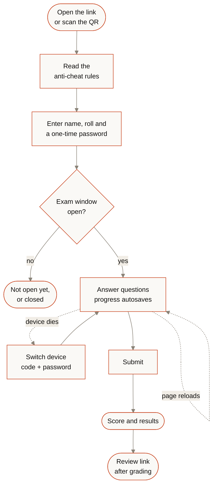

- **Reloads are safe.** The student comes back to the same questions in the same shuffled order, with their answers and name intact, and the clock keeps running from the original start.
- **One attempt per browser,** and no new starts once the window has closed.

</details>

<details>
<summary><b>What happens behind the scenes during a live exam</b></summary>
<br>

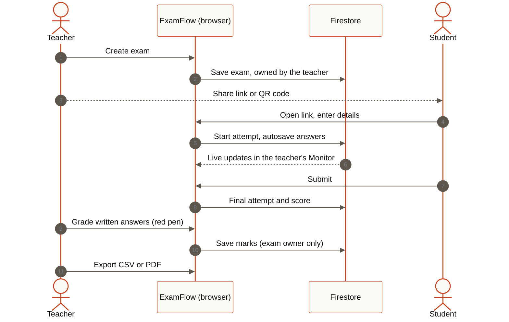

</details>

<br>

## A look inside

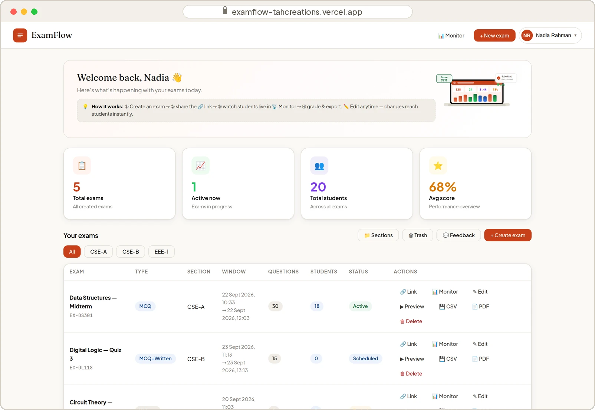
<p align="center"><sub><b>Teacher dashboard.</b> Every exam at a glance: status, window, questions, students, and one-click link, monitor, preview and exports.</sub></p>

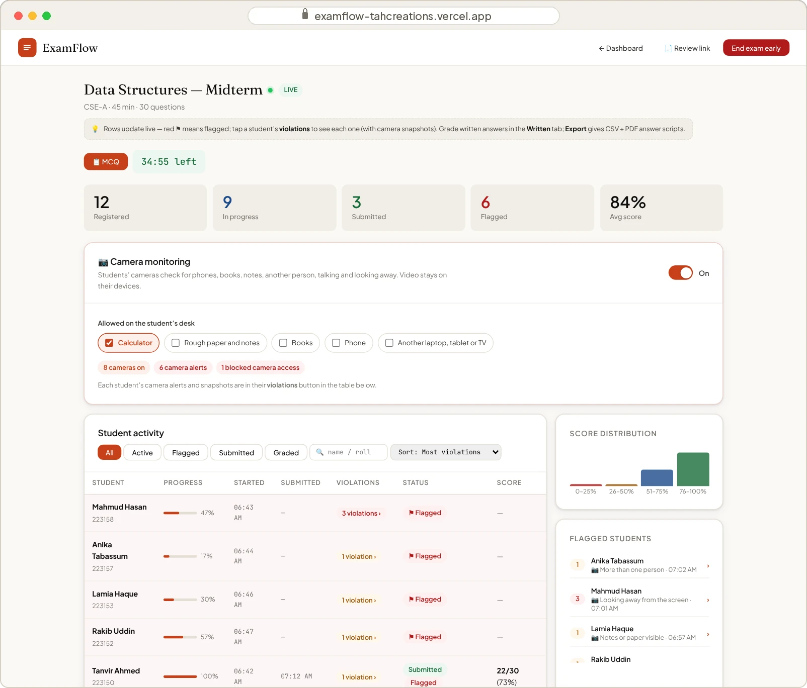
<p align="center"><sub><b>Live monitor.</b> Progress per student, flags, a score distribution and a timestamped violation log, updating in real time.</sub></p>

<table>
<tr>
<td width="50%" valign="top" align="center">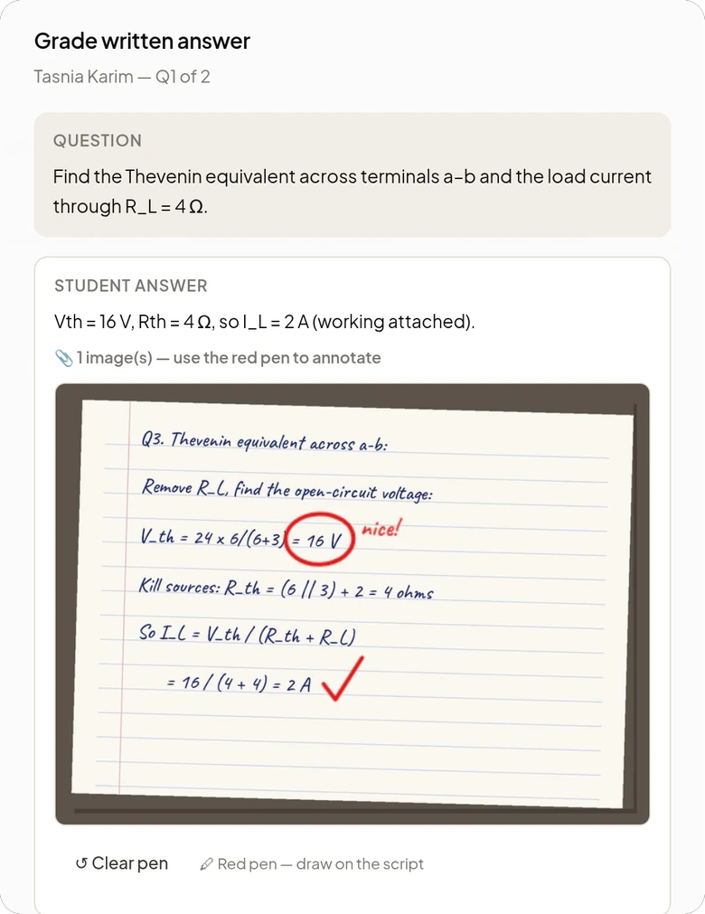<br><sub><b>Red-pen grading.</b> Mark photographed handwritten answers right on the script.</sub></td>
<td width="50%" valign="top" align="center">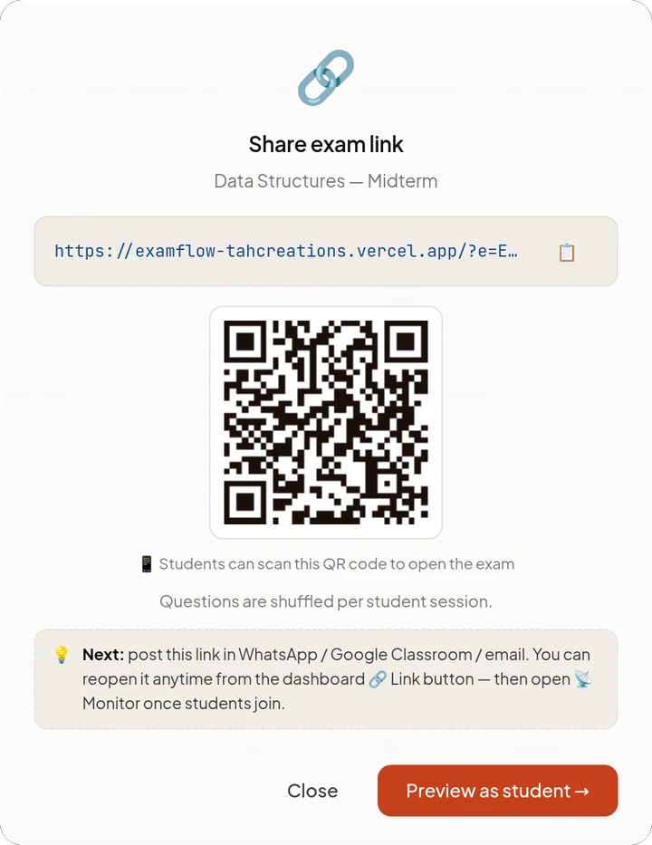<br><sub><b>One link, one QR.</b> Post it in WhatsApp, Google Classroom or email.</sub></td>
</tr>
</table>

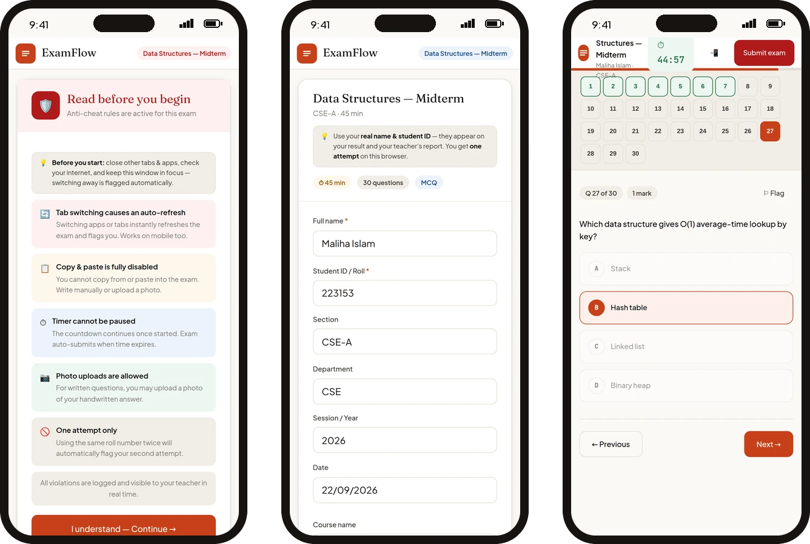
<p align="center"><sub><b>The student's phone.</b> Anti-cheat rules, then their details, then the exam, with a question map, timer and flags.</sub></p>

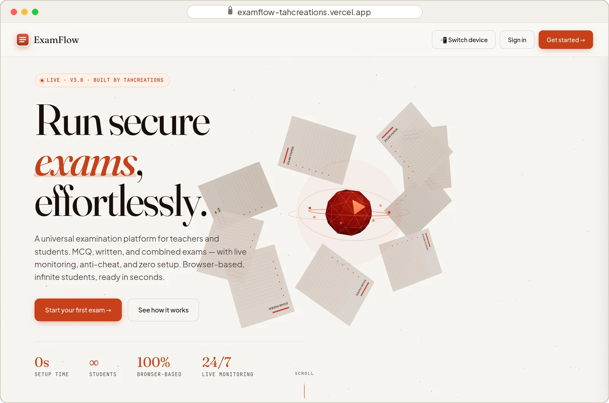
<p align="center"><sub><b>The front door.</b> Teachers sign up with email or Google and create their first exam.</sub></p>

<br>

## Features

<table>
<tr>
<td width="33%" valign="top">

**Build**

MCQ, written, or combined exams. Import questions from a CSV; a built-in prompt turns any question file into the right format with ChatGPT. Set marks per MCQ, a duration, and an opening and closing time.

</td>
<td width="33%" valign="top">

**Share**

One link and a QR code per exam. Optional student list, so students pick their name instead of typing it. Questions and options can shuffle per student.

</td>
<td width="33%" valign="top">

**Watch**

A live monitor with progress, submissions, flags and a timestamped violation log. Search, filter, sort, and see the score distribution form.

</td>
</tr>
<tr>
<td width="33%" valign="top">

**Protect**

Leaving full screen, switching tabs, copy/paste, right-click, blocked shortcuts, screenshot keys and leaving the page are all logged, per student, with a timestamp.

</td>
<td width="33%" valign="top">

**Grade**

MCQs mark themselves. Written answers get a red-pen layer on photos. Combined exams keep the MCQ marks in the total.

</td>
<td width="33%" valign="top">

**Export**

Results as CSV, answer scripts as PDF, and a private review link where each student sees only their own graded script.

</td>
</tr>
</table>

<details>
<summary><b>Everything teachers get</b></summary>
<br>

- **Three exam types:** MCQ, written, and combined (an MCQ section, then a timed written section). Either section of a combined exam can be left empty.
- **Scheduling:** an opening time, a closing time (which must come after the opening time) and a duration, or no timer at all. Ended exams can be reopened with a new window.
- **Drafts, live edits and sections:** save drafts, edit a live exam (students get the change instantly), group exams into sections, and restore deleted exams from the trash.
- **Grading safety:** if saving marks fails, you're told instead of seeing "Marks saved".
- **Safe exports:** in CSV exports, spreadsheet formulas typed into student names are neutralised.
- Teacher and student manuals, plus an in-app feedback form.

</details>

<details>
<summary><b>Everything students get</b></summary>
<br>

- **No account, no install.** Open the link, read the rules, enter your details, start.
- **Safe to refresh.** Same questions, same shuffled order, answers, name and roll kept, and the clock keeps its original start, so a reload can't reset the timer.
- **Device switching.** If a phone dies, **Switch device** resumes the same unsubmitted attempt elsewhere with a code and the student's one-time password.
- **Photo answers.** Handwritten work can be photographed for written questions. Photos are compressed in the browser (a 12-megapixel photo becomes roughly 100–250 KB) and each attempt holds about 700 KB of them. The first photos stay sharp, later ones get smaller, and the student is told when the limit is reached.
- **Clear outcomes.** One submission per browser, no new starts after the window closes, and if a submission can't reach the teacher, the student is told to keep the page open.

</details>

<br>

## Admin Monitor

For the owner only: sign in with the admin email, then avatar menu → **Admin Monitor**.

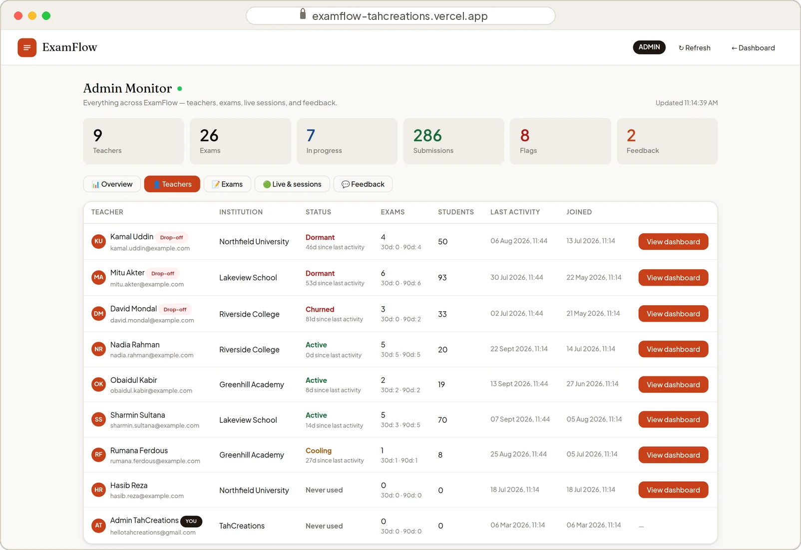

| Tab | What you see |
|---|---|
| **Overview** | Teachers, exams, attempts in progress, submissions, flags, feedback |
| **Teachers** | Every teacher's activity status, exams in the last 30 and 90 days, students, last activity, join date, and **View dashboard** |
| **Exams** | Every exam with its owner, status and attempts; open its sessions, the owner's dashboard, or delete it |
| **Live & sessions** | Every attempt across the platform |
| **Feedback** | The inbox from the in-app form |

**Status** is **Active** (used in the last 14 days), **Cooling** (15–30), **Dormant** (31–60), **Churned** (over 60) or **Never used**. **Drop-off** marks teachers who ran 3–6 exams and then went quiet for over 30 days, and sorts them to the top: the people worth asking why they stopped.

### View any teacher's dashboard

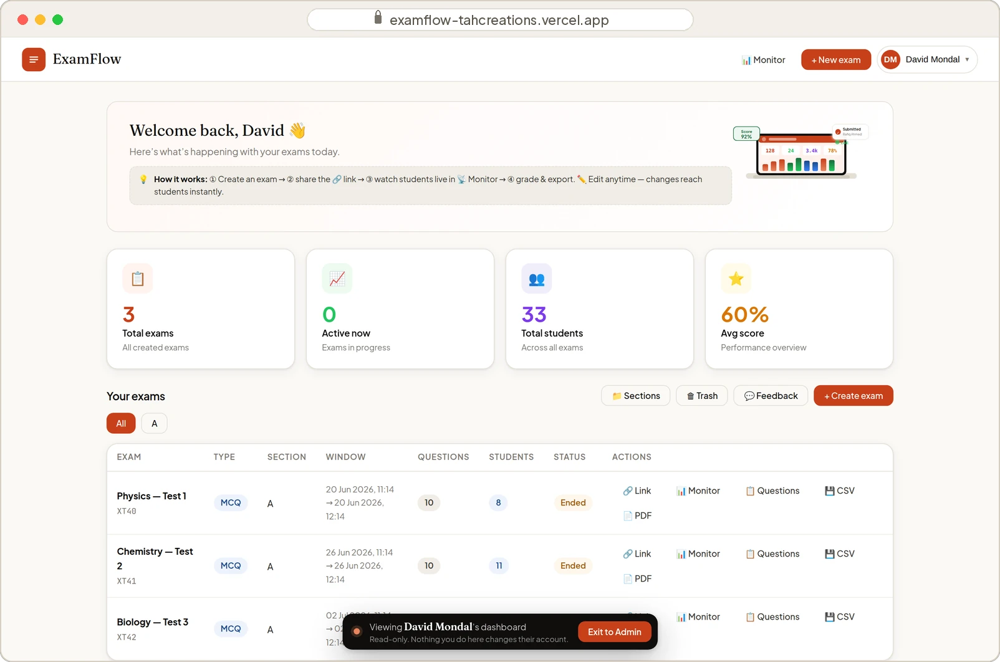

**View dashboard** opens a teacher's dashboard exactly as they see it: their exams, stats, sections and trash, and each exam's monitor with results, violation logs and written answers. The bar at the bottom shows whose dashboard is open; **Exit to Admin** takes you back.

<details>
<summary><b>How the read-only lock works</b></summary>
<br>

- **Disabled while viewing:** creating, editing, deleting, restoring, publishing, reopening and ending exams, saving marks, adding sections, sending feedback and signing out.
- **Preview becomes a question sheet** with the correct answers ticked. A real preview runs an exam session that would write into their exam.
- **A safety net on the Firestore SDK** refuses every write while the view is open, even from a code path nobody remembered to guard.
- **Fresh data every time,** loaded with the same queries their own dashboard runs. Sections are rebuilt from their exams, because each teacher's sections are saved in their own browser.

</details>

<br>

## Under the hood

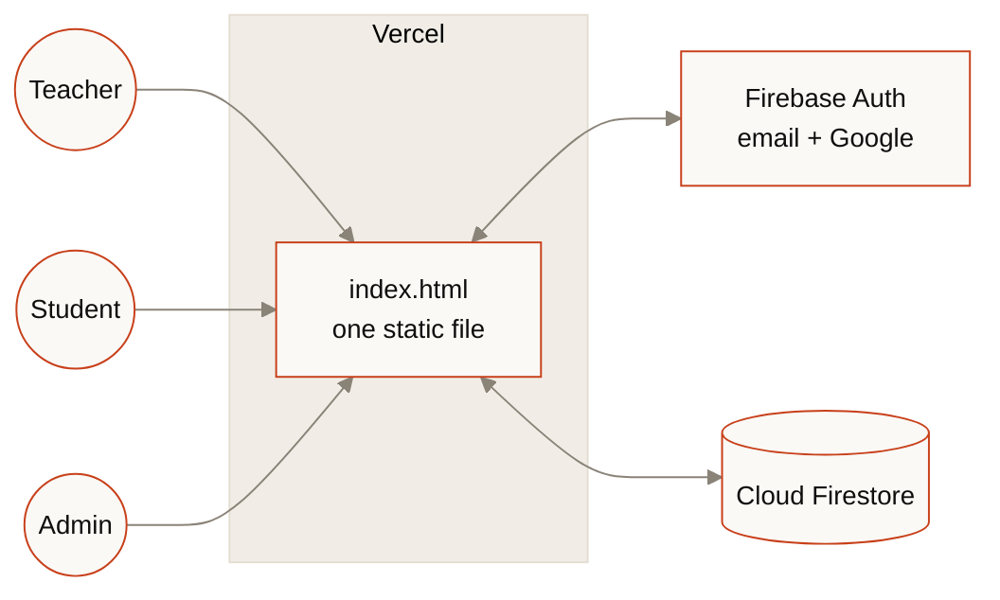

- **One static file.** `index.html` holds all the markup, styles and scripts. No server of its own, no build step.
- **Firebase** (compat SDK 10.7.1): Authentication (email/password and Google, with a redirect on phones) and Cloud Firestore.
- **Libraries from CDNs:** GSAP 3.12.5 and three.js 0.160 for the landing page, plus jsPDF 2.5.1 and qrcodejs 1.0.0, which load only when needed.
- **Hosting:** Vercel, as a static site.

<details>
<summary><b>Data model</b></summary>
<br>

| Collection | What it holds | Written by |
|---|---|---|
| `teachers/{uid}` | Teacher profile | The teacher, at sign-up |
| `exams/{token}` | Exam definition, keyed by its share token | The teacher who owns it |
| `sessions/{id}` | One student attempt | The student's browser; the owning teacher when grading |
| `feedback/{id}` | Feedback form entries | Anyone |
| `meta/stats` | Visit counter (no personal data) | Any visitor |

Exam sections live in each teacher's browser (localStorage). The browser cache never blocks the app: if it fills up, it's saved without photos (Firestore still has them) and exams keep working.

</details>

<details>
<summary><b>What's in this repository</b></summary>
<br>

| File | Purpose |
|---|---|
| `index.html` | The entire app |
| `firestore.rules` | Cloud Firestore security rules |
| `database.rules.json` | Realtime Database rules; the app doesn't use it, so they deny everything |
| `firebase.json`, `.firebaserc` | Let the Firebase CLI deploy both rule files to project `examflow-195df` |
| `assets/` | The images in this README |
| `CHANGELOG.md` | Version comparison and the reason for every change |

</details>

<details>
<summary><b>What it costs to run</b></summary>
<br>

| Piece | Cost |
|---|---|
| Vercel Hobby hosting | Free |
| Firebase Spark plan | Free. Past the daily limits (50,000 reads, 20,000 writes, 1 GB stored), requests pause until the next day instead of billing you |
| AI or paid APIs | None. ExamFlow calls no AI service and has no email or payment integration |

The biggest reader is the Admin Monitor, which reads every teacher, exam, attempt and feedback entry each time it opens.

</details>

<br>

## Run your own copy

1. **Create a Firebase project.** Enable Authentication → Sign-in method → **Email/Password** and **Google**. Create a **Cloud Firestore** database. Realtime Database isn't needed.
2. **Authorize your domain.** Authentication → Settings → Authorized domains → add the domain you'll host on, such as `your-app.vercel.app`. Google sign-in fails on unlisted domains.
3. **Point the app at your project.** In `index.html`, replace the config inside `firebase.initializeApp({...})` with your project's web config.
4. **Set the admin.** Change `const ADMIN_EMAILS` in `index.html` and `adminEmails()` in `firestore.rules`. They must match.
5. **Publish the rules** (below).
6. **Deploy on Vercel.** Import this repository → framework preset **Other** → no build command → output directory is the repository root. Every push to `main` redeploys.

<details>
<summary><b>Publishing the security rules</b></summary>
<br>

**From the Firebase Console:** Firestore Database → **Rules** → paste `firestore.rules` → **Publish**. If the project has a Realtime Database, do the same with `database.rules.json` under Realtime Database → **Rules**.

**From the Firebase CLI:**

```bash
npm install -g firebase-tools
firebase login
firebase deploy --only firestore:rules,database
```

</details>

<br>

## Security

> [!NOTE]
> **Students never sign in.** Single-exam reads and the `sessions` collection stay open so signed-out browsers can take, resume and review exams. Listing exams is limited to each exam's owner and the admin.

> [!IMPORTANT]
> **Scores are calculated in the student's browser,** and the exam, answer key included, reaches that browser. There is no server to hide it behind, so a technically skilled student could tamper with their own attempt before submitting. Keep that in mind for high-stakes exams.

- **Submitted attempts are locked.** Only the teacher who owns the exam, or the admin, can change an attempt after it's submitted. Any other account, and any signed-out browser, is refused.
- **Teachers only touch their own data.** They can read, edit and delete their own exams, and can't hand an exam over to another account.
- **Student-supplied text is always shown as text.** Names, scores, violation labels and photo data can't inject markup or scripts into the monitor, the grading screen or the Admin Monitor.
- **The read-only teacher view is enforced in the app,** not in the rules; the rules keep the admin's delete powers.
- **Realtime Database is fully locked,** since nothing uses it.

> [!TIP]
> **Admin rights come from one email,** set in `adminEmails()` and `ADMIN_EMAILS`. Keep that account's sign-in secure.

<br>

## FAQ

<details>
<summary><b>Do students need an account or an app?</b></summary>
<br>
No. They open the link or scan the QR code in any modern browser, on a phone or a computer.
</details>

<details>
<summary><b>Does ExamFlow use the camera to watch students?</b></summary>
<br>
No. Anti-cheat is based on behaviour (full screen, tab switches, copy/paste, right-click, shortcuts, leaving the page), and every event is logged for the teacher. The camera opens only when a student taps <b>Take photo</b> to attach handwritten work.
</details>

<details>
<summary><b>What if a student's phone reloads or dies mid-exam?</b></summary>
<br>
A reload brings them back to the same questions in the same order with their answers, and the timer keeps its original start. If the phone dies, <b>Switch device</b> resumes the same attempt on another device with a code and their one-time password.
</details>

<details>
<summary><b>How many photos can a student attach?</b></summary>
<br>
About 700 KB of photos per attempt, roughly 5–10 phone photos: the first ones stay sharp and later ones get smaller. An attempt is a single Firestore document, which caps at 1 MB.
</details>

<details>
<summary><b>Can a student change their score?</b></summary>
<br>
Not after submitting: only the exam's teacher or the admin can edit a submitted attempt. Before submitting, a technically skilled student could tamper with their own attempt, because scoring happens in the browser (see <a href="#security">Security</a>).
</details>

<details>
<summary><b>Does it cost anything?</b></summary>
<br>
Not on Vercel's Hobby plan and Firebase's Spark plan. There are no AI, email or payment services built in. See <b>What it costs to run</b> under <a href="#under-the-hood">Under the hood</a>.
</details>

<br>

---

<div align="center">

**ExamFlow v38** · Built by **TahCreations** · <a href="mailto:hellotahcreations@gmail.com">hellotahcreations@gmail.com</a>

<sub>Full history and the reason behind every change: <a href="CHANGELOG.md">CHANGELOG.md</a></sub>

</div>
