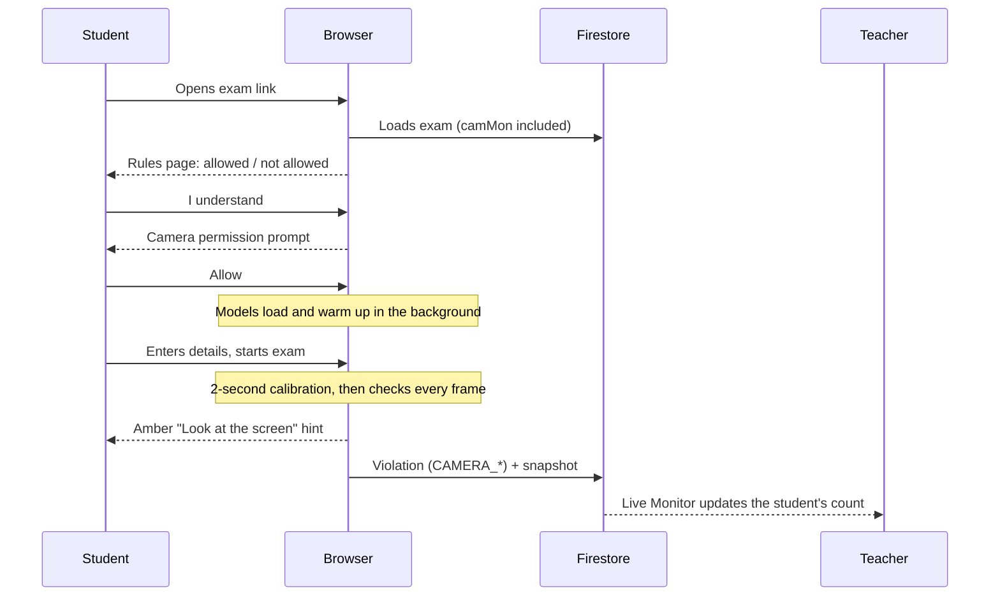
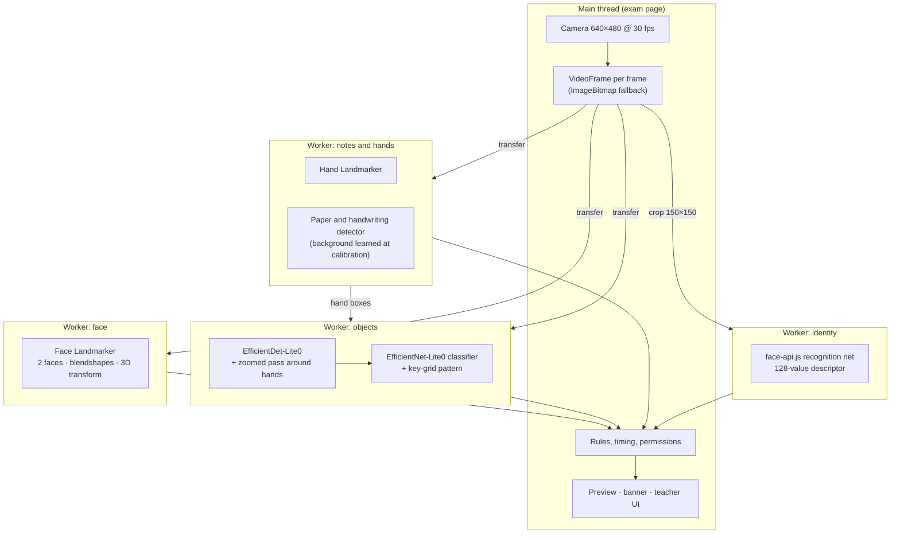

# Camera monitoring: technical guide

[← Back to README](../README.md) · Added in **v39** · updated in **v44** and **v45**

Camera monitoring uses each student's own camera during an exam to flag phones, books, notes, another person, talking, head turning, looking away or down, and a different person taking over. Everything is analysed in the student's browser. Video is never uploaded; only alerts and small snapshots reach the teacher.

> [!NOTE]
> The same guide is inside ExamFlow, in plain words, for teachers and for students: **❔ How it works** next to the camera switch, **🎥 Camera monitoring** on the landing page, and **Exams with the camera on** in the student guides. This page is the technical version.

## Contents

- [For teachers](#for-teachers)
- [For students](#for-students)
- [Detection rules](#detection-rules)
- [Allowed items](#allowed-items)
- [Architecture](#architecture)
- [Data stored in Firestore](#data-stored-in-firestore)
- [How it hooks into ExamFlow](#how-it-hooks-into-examflow)
- [Tuning](#tuning)
- [Troubleshooting](#troubleshooting)
- [Limitations](#limitations)

---

## For teachers

| Where | What you can do |
|---|---|
| **Create exam** (MCQ, Written, MCQ + Written) → settings | Turn **📷 Camera monitoring** on and tick the allowed items. Off by default. |
| **Edit exam** | Change the setting at any time. |
| **Live Monitor** → Camera monitoring card | Same switch and items. See how many cameras are on, blocked or missing, and the total of camera alerts. |
| **Live Monitor** → a student's **violations** button | That student's violations only: label, time, question number and snapshot. Tabs: All, Camera, Browser, Camera notes. |
| **Live Monitor** → **Flagged students** | One row per flagged student; a row opens the same window. |

Changes made while an exam is running reach students already taking it within a second or so, and they see a short notice.

> [!TIP]
> Turn the camera on **before** sharing the link. Students who already passed the rules page still get it, but they'll be asked for the camera in the middle of the exam.

## For students



- If the camera is blocked, the student sees how to allow it. After a second refusal, or if no camera exists, **Continue without camera** appears and the teacher gets `CAMERA_ACCESS_DENIED` or `CAMERA_NOT_AVAILABLE`.
- The preview window can be dragged to any corner (remembered per device) and tapped to shrink. On phones it starts small, and the end of the exam page gets extra room so scrolling down lifts **Next** and **Submit** above the preview.
- Real alerts use the exam's existing red banner, with "your teacher has been notified".

## Detection rules

Times are how long a condition must last before it counts ("on"), and how long it must be gone before the alert ends ("off").

| Alert | Severity | Condition | On | Off |
|---|---|---|---|---|
| No one at the screen | 🔴 High | No face and no person detected | 1.5 s | 0.6 s |
| Face not visible | 🟠 Medium | No face, but a person may be there | 1.5 s (4 s if paper or a calculator is allowed) | 0.4 s |
| More than one person | 🔴 High | Two faces, or two bodies for 1 s more | 0.5 s | 1.2 s |
| Different person in front of the camera | 🔴 High | 2 of the last 3 identity checks don't match the calibrated face | immediate | 3 s |
| Phone visible | 🔴 High | Classified as a phone in 2 of the last 4 object checks, or seen clearly once (detector ≥ 0.70 and the phone-or-calculator check ≥ 0.65) | immediate | 1.2 s |
| Calculator visible | 🔴 High | Classified as a calculator in 2 of the last 4 checks (only when not allowed) | immediate | 1.2 s |
| Handheld device, could be a phone | 🔴/🟠 | Unclear device in 3 of the last 5 checks; medium when calculators or phones are allowed | immediate | 1.2 s |
| Book visible | 🔴 High | Book in 2 of the last 4 checks, not part of the calibrated background | immediate | 1.2 s |
| Notes or paper visible | 🔴 High | Paper with writing in 3 of the last 5 notes checks | immediate | 1.2 s |
| Holding something up to the camera | 🔴 High | A hand overlaps a not-allowed object or paper in 2 of the last 4 checks | immediate | 1.2 s |
| Another screen visible | 🟠 Medium | Laptop or TV not in the calibrated background | 0.6 s | 1.2 s |
| Looking away from the screen | 🟠 Medium | Head turned 20° or more | 1.5 s | 0.4 s |
| Repeated head turning | 🟠 Medium | 3 turns (20° for 0.25 s) within 30 s | — | — |
| Looking down, away from the screen | 🟠 Medium | Nose-to-chin ratio rises 0.10 above calibration (only when paper and calculators aren't allowed) | 2 s | 0.5 s |
| Repeated talking | 🟠 Medium | 3 talking episodes within 60 s | — | — |
| Camera covered or too dark | 🔴 High | Very dark or completely uniform image | 1 s | 0.8 s |
| Camera stopped | 🔴 High | Camera track ended or muted | immediate | 0.5 s |
| Talking · Repeated side glances | ⚪ Note | Kept as snapshots under **Camera notes**, not counted as violations | | |

Each alert type is reported at most once every 15 s. An alert that stays on is reported again every 45 s with a new snapshot.

## Allowed items

| Item | Alerts it turns off | Side effects |
|---|---|---|
| Calculator | Calculator visible; holding a calculator | *Face not visible* waits 4 s; looking down isn't flagged |
| Rough paper and notes | Notes or paper visible; holding paper | *Face not visible* waits 4 s; looking down isn't flagged |
| Books | Book visible; holding a book | |
| Phone | Phone visible; holding a phone | |
| Another laptop, tablet or TV | Another screen visible | |
| *(automatic)* paper in written exams | Notes or paper visible | Also in the written part of a combined exam |

*Handheld device, could be a phone* is raised unless **both** phone and calculator are allowed.

## Architecture



| Model | Source | Used for |
|---|---|---|
| `face_landmarker.task` (float16) | MediaPipe | Faces, head pose, mouth, eyes |
| `hand_landmarker.task` (float16) | MediaPipe | Hands, zoom area, held objects |
| `efficientdet_lite0.tflite` (float16) | MediaPipe | Person, phone, book, laptop, TV |
| `efficientnet_lite0.tflite` (int8, float32 fallback) | MediaPipe | Phone vs calculator |
| `face_recognition_model` | `@vladmandic/face-api` 1.7.15 | Same-person check |

- Libraries: `@mediapipe/tasks-vision` 0.10.14 and `@vladmandic/face-api` 1.7.15 from jsDelivr; models from Google's public model storage. No API keys.
- **Four workers, side by side** (v44). Face, objects, notes-and-hands and identity each run in their own worker at the same time, so no check waits for another. Before v44 the hand finder, the object detector and the notes check shared one worker and ran one after another. If the notes worker can't start, hands and paper go back into the objects worker.
- Each model is timed on the GPU and, if the GPU looks slow (some machines only have a software GPU), on the CPU too, and keeps whichever is faster. **Checked on real frames** (v44): when the GPU wins, its first 12 real camera frames are watched too. If it finds no face or person at all, or runs much slower than the test said, the model moves to the CPU. Before, a GPU that found nothing could stay for the whole exam and cause endless *Face not visible* alerts, or none for phones. If workers aren't available at all, the engines run on the main thread with lower rates (face 10 Hz, objects 2.5 Hz) to keep the exam smooth. A worker that keeps failing on frames is moved to the main thread automatically.
- Only one frame is in flight per worker, so lag can't build up. Face checks run as often as the device allows, up to every camera frame; object checks adapt between 3 and 20 per second, and the notes check runs on its own, several times a second. On a slow 2-core test machine one object round takes about 0.19 s and *Notes or paper visible* fires about 3.6 s after notes appear.
- Models start loading on *Read before you begin* (camera exams only) and are run once on a blank frame while loading, so GPU shaders are ready before the exam.
- **Head pose** is read from MediaPipe's facial transformation matrix (layout-independent), with a landmark-based fallback, and smoothed with a One Euro filter.
- **Calibration** (2 s, at least 25 frames with exactly one face) records the straight-ahead angle, the looking-down ratio, the closed-mouth position, the face identity (2–5 samples), the empty background for the notes detector, and background books, laptops and TVs. If no single face is seen within 8 s (student away, dark room), monitoring starts anyway: *No one at the screen* and the object checks run straight away, and the head, eye and mouth baseline is learned as soon as the face appears.
- **Late start:** if the rules page or a resumed exam is already on screen when the camera script finishes loading, it picks up from there.
- **Freshness:** a result counts as current for a little longer than one inference takes, so slow devices still raise alerts.

## Data stored in Firestore

```js
// exams/{token}: written by the owning teacher
camMon: { on: true, allow: { calculator: true, roughPaper: false, books: false, phone: false, screens: false } }

// sessions/{id}: written by the student's browser before submission
violations: [{ type: 'CAMERA_LOOKING_AWAY_FROM_THE_SCREEN', time: '…', q: 3 }]   // via the existing logViol()
camShots:   [{ t: 1791283333000, l: 'Looking away from the screen', s: 'medium', img: 'data:image/jpeg;base64,…' }]
camStatus:  { state: 'on', t: 1791283300000 }   // on | denied | unavailable | off
```

- Snapshots are 128×96 JPEG at quality 0.55, about 4 KB each; the last 12 are kept (about 50 KB per attempt).
- Violation types are `CAMERA_` plus the alert label in capitals, so existing CSV exports and counts include them automatically.
- **No rule changes are needed:** `camMon` is an owner-written exam field (written with `teacherUid`), and the session fields are written before submission, which the existing rules allow.

> [!WARNING]
> `sessions` is world-readable by design (signed-out students must resume and review), so snapshots are as readable as the rest of an attempt. Moving them to a teacher-only collection is planned.

## How it hooks into ExamFlow

The module is one self-contained `<script>` near the end of `index.html` (`window.EFCam`). It doesn't edit existing functions; it wraps them at load time:

| Existing function | What the camera adds |
|---|---|
| `setupAC` / `teardownAC` | Start or stop monitoring with the anti-cheat. Stop is delayed 2.5 s so a combined exam keeps the camera on between parts. |
| `showACWarn` | Camera rules box; starts model downloads; refreshes `camMon` from Firestore. |
| `goStudentForm` | Asks for the camera before continuing; handles blocked or missing cameras. |
| `initMCQModal` / `initWrtModal` / `initCombinedModal` | Resets the camera section to off. |
| `createMCQ` / `createWRT` / `createCombined` | Saves `camMon` on the new exam (only if one was actually created). |
| `editExam` / `saveEditExam` | Loads and saves the setting (only if validation passed). |
| `openMonitor` / `renderMon` | Camera card and live updates for the student window. |

The only direct edits to existing code are in `renderMon` (the violations badge became a button, the sidebar became the Flagged students list, and labels moved into `_violLabel()`) and one CSS rule that keeps the exam pages free of `content-visibility` containment, so the fixed red warning banner stays on screen after a student scrolls.

## Tuning

Thresholds live in `const CFG` at the top of the camera module in `index.html`:

```js
const CFG = {
  headTurnDeg: 20, turnHoldMs: 250, gazeThreshold: 0.35, turnsForRepeat: 3, glancesForRepeat: 4, repeatWindowSec: 30, lookAwaySec: 1.5,
  lookDownDelta: 0.10, lookDownSec: 2,
  talkDelta: 0.055, talkEpisodesForRepeat: 3, talkWindowSec: 60,
  phoneConfidence: 0.40, bookConfidence: 0.35, paperMinBright: 135, notesEdge: 0.025,
  idThreshold: 0.55, idEverySec: 2, detector: 'lite0'
};
```

<details>
<summary>What each value does</summary>

<br>

| Key | Meaning | Lower means |
|---|---|---|
| `headTurnDeg` | Degrees from straight ahead that count as turned | More sensitive |
| `turnHoldMs` | How long a turn must last to count | Catches quicker turns |
| `lookAwaySec` | Seconds turned before *Looking away* | Faster alert |
| `lookDownDelta` / `lookDownSec` | Looking-down threshold and duration | More sensitive / faster |
| `talkDelta` | Mouth opening that counts as speech | More sensitive |
| `phoneConfidence` / `bookConfidence` | Detector confidence required | More detections, more false alarms |
| `paperMinBright` / `notesEdge` | Paper brightness floor / writing density | Catches dimmer paper / lighter writing |
| `idThreshold` | Face distance that counts as a different person | Stricter |
| `detector` | `'lite0'` (fast) or `'lite2'` (more accurate, slower) | |

</details>

## Troubleshooting

| Symptom | Likely cause | Fix |
|---|---|---|
| No camera box on the rules page | Camera monitoring is off for that exam | Turn it on in Create or Edit exam, or the Live Monitor |
| `EFCam is not defined` in the console | Old `index.html` still deployed | Push the new file, wait for Vercel, hard-refresh (Cmd + Shift + R) |
| Setting turns itself off after reload | Firestore rejected the write | Check the console for `camera setting save`; publish `firestore.rules` from this repo |
| "Camera access was blocked" | Browser or OS permission denied | Allow the camera from the address bar; on macOS also System Settings → Privacy → Camera |
| "Your camera could not start" | Another app is using the camera | Close Zoom, Meet, Photo Booth, then try again |
| Camera never starts | Page opened over `http://` or `file://` | Use HTTPS (Vercel) or `localhost` |
| Very slow on an old phone | No worker or GPU support, so it runs on the main thread | Expected; rates are lowered automatically |
| The preview covers a button | The student hasn't scrolled to the end | Scroll down (there's extra room for this), drag the preview to another corner, or tap it to shrink |
| A bookshelf triggers *Book visible* | The shelf wasn't visible during calibration (lighting or camera angle changed) | The student can refresh the page: the exam resumes where it was and the camera recalibrates |

## Limitations

- The camera only sees what's in front of it: notes flat on the desk below the screen, or a phone held above the laptop, can't be seen.
- Coloured sticky notes, dark paper and blank paper aren't treated as notes.
- Chewing can look like talking. Strong backlight can hide the face.
- Students download about 30 MB of models once (cached afterwards).
- Snapshots are readable like the rest of an attempt (see the warning above).
