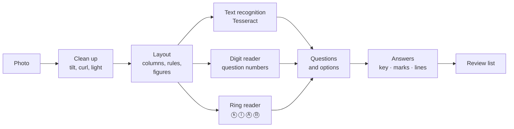

# Paper reader: technical guide

[← Back to README](../README.md) · Added in **v40** · rebuilt in **v44** and **v45** · written papers in **v46**

The paper reader turns a question paper into exam questions: question text, options, the correct answer and diagrams. It reads phone photos, scanned PDFs, typed PDFs, Word files (`.doc` and `.docx`), CSV and JSON. Everything runs in the teacher's browser. Nothing is uploaded, no AI service is called, and nothing costs money.

> [!NOTE]
> Teachers have the same guide inside ExamFlow in plain words: **❔ How the paper reader works** under every upload box, and **📷 Reading a question paper** on the landing page. This page is the technical version.

## Contents

- [For teachers](#for-teachers)
- [What it reads](#what-it-reads)
- [Where the answer comes from](#where-the-answer-comes-from)
- [How photos and scans are read](#how-photos-and-scans-are-read)
- [How typed PDFs are read](#how-typed-pdfs-are-read)
- [How Word files are read](#how-word-files-are-read)
- [Pictures and diagrams](#pictures-and-diagrams)
- [Written papers (v46)](#written-papers-v46)
- [Accuracy](#accuracy)
- [Limitations](#limitations)
- [Troubleshooting](#troubleshooting)

---

## For teachers

1. In **Create exam**, open **Questions** and drop one or more files into the upload box. Several photos can go in at once.
2. ExamFlow reads them and opens a review list: every question with its options, its answer, and where the answer came from.
3. Check the list. Answers the reader is less sure of say **Confirm**. Questions with options it could not read show empty boxes to fill in; they can't be added until they're filled.
4. Click **Add** to put the questions in the exam.

> [!TIP]
> A typed PDF or Word file is always more accurate than a photo of it. For photos: hold the phone flat over the page, in good light, one page per photo, and photograph the answer-key page too.

## What it reads

| File | How |
|---|---|
| Photos (JPG, PNG, WebP; several at once) | Text recognition per page, then pages are sorted by their question numbers |
| Scanned PDF | Each page is drawn to an image and read like a photo |
| Typed PDF | Text and positions are taken from the file itself (pdf.js), so no recognition is needed |
| `.docx` | The document XML is read directly (JSZip): text, tables, equations, pictures, drawings, text boxes |
| `.doc` (Word 97–2003) | ExamFlow's own reader for the old binary format: text, tables, equation fields, WMF/EMF pictures and drawings |
| CSV / JSON | Loaded as a question bank (`Question,A,B,C,D,Answer`) |

Languages: Bangla, English, and papers that mix both. Bijoy (SutonnyMJ) text is found and turned into Unicode on its own.

## Where the answer comes from

The reader uses whichever of these the paper has, and shows the source beside each answer:

| Source | Examples |
|---|---|
| Answer key or grid | "53. d \| 54. a", "০১. খ", "১।খ ২।ক", a table with the number and the letter in separate cells |
| A marked option | circled, ticked (✓), **bold**, underlined, shaded or coloured |
| An answer line | "Ans: B", "উত্তর: (খ)", "ঘ ২৮০ টাকা (গ) ✓" after the last option |
| A pen mark on a printed photo | a circle or tick drawn by hand |
| Worked out | number questions with no key: an exact calculator finds the value and ticks the matching option, marked **Worked out** for the teacher to confirm |

An answer key printed inside one column goes with the questions in that column. A page of written questions numbered from 1 again after the MCQs doesn't take the MCQ key.

## How photos and scans are read

The general text reader is Tesseract.js 7.0.0 with the Bangla + English model in `tessdata/`. On top of it, ExamFlow adds its own steps:

- **Digit reader for question numbers.** Text recognition often misreads numbers ("53." as "S3." or "৭),"). ExamFlow draws the digits 0–9 and ০–৯ in many fonts on the page itself, then matches each number against them. Nothing is downloaded and no outside model is used.
- **Numbers count up.** Question numbers on a page run 53, 54, 55… A number that breaks the run is not used, and a number that could not be read is filled in from its neighbours.
- **Answer-key tables are read cell by cell**, so each number and letter is read on its own. Lines of the table the scan lost are put back.
- **Option letters in rings** (ⓚ ⓛ ⓜ ⓝ, Ⓐ Ⓑ Ⓒ Ⓓ) have their own reader; options are also lettered by their order along the line.
- **Two-column pages** with a printed line between the columns are read one column at a time. Question numbers printed in the gap between the columns start the right-hand question.
- **Tilted and curled photos.** Number columns that drift across a tilted photo are followed; faint or blurred numbers are read better; digits that run together are split.
- **Page order.** Several photos are put in order by their question numbers, even when one photo's first number is misread.

## How typed PDFs are read

- **Columns** are found from where the text sits on the page. Tables, banners and lines across the page are handled.
- **Ticks and bubbles** printed in symbol fonts are read.
- **Bold, underline, shading and colour** on an option mark the answer.
- **Page numbers and running headings** are removed. Subscripts and superscripts are kept.
- A PDF with no text layer (a scan) is read like photos instead.

## How Word files are read

- **Drawings and text boxes** in both `.doc` and `.docx` are kept, and shapes are drawn into pictures.
- **Old equation fields** are read, including Bijoy inside equations.
- **Old WMF/EMF pictures** are drawn by ExamFlow's own picture reader.
- More answer forms are found, such as keys written "১।খ ২।ক" and questions with five options.

## Pictures and diagrams

- A cut-out is made only for a **real drawing**: a shape, a graph, a circuit, a map. The test is about lines, not words: a drawing has a large line shape that spreads in two directions, with thin lines, and no sentence runs through it.
- Formulas, handwriting, ticks, crossings-out, boxed headings, watermarks and page edges are read as text or left out.
- The cut-out is tight: the drawing and its labels (A, B, R = 8 Ω, x, y), not the lines around it.
- Pictures that can't be placed in a question wait under **Pictures not placed in a question**.
- Matrices and determinants are written as typed maths (KaTeX), so students see them laid out.

## Written papers (v46)

When a paper is read into a **written** exam (or the written part of a combined exam), each question is split into its **stem** and its **parts**, and checked before anything is added. All of it is rules written for ExamFlow (`efread-written.js`); there is no AI and no service.

| What | How it is read |
|---|---|
| Parts | `(a)` `a)` `a.` `[a]`, `ক.` `ক)` `(ক)`, in order. `(i)` `(ii)` inside a part stay in that part. A camera-blurred label (`Ab)`, `0 (b)`) is accepted only for the letter expected next, and a lost label is placed where the part before ends with its mark — both with a warning. |
| Marks of a part | `(03)`, `[3]`, `(3.5)`, `3 marks`, a Bangla digit at the end of the line (`… নির্ণয় কর। ৪`), a mark after a tab or a sentence end in typed files, `1×10=10` / `0.5×10=5` / `1/2 ×10=5` (also when the × was lost: `110=10`). Lines that are only a piece of a formula (the lower half of a fraction) or a section heading are looked past. |
| Marks of the question | The parts added up. When the paper prints a total that disagrees, the printed total is kept and the question says so. When nothing is printed, the box stays **empty** and the question can't be added until the teacher fills it in. Marks from a heading such as `(2 × 10 = 20)` are used only when nothing is printed on the questions, and say so. |
| Printed solutions | `১নং প্রশ্নের সমাধান`, `Solution:`, `Answer:`, `উত্তর:` and everything after it is left out, with a note on the question. A file that is mostly worked solutions is flagged at the top of the review. |
| Tables | Two or more lines with the same number of cells (a label and numbers) are kept row by row, cells separated by `|`, with a note. |
| Figures | Drawings are attached as before. A question that refers to a figure (`চিত্রে`, `in the figure`, `shown below`…) with no picture found says so. |
| Pages | Each question shows the page of the file it is on. |
| Order | Questions out of order or twice are flagged. A written question whose number was lost (its parts start again at `(a)`/`ক` after another question's `(c)`/`গ`) is split off and marked for checking. |
| Instructions | "Answer any two…", "[দ্রষ্টব্য : … সাতটি প্রশ্নের উত্তর দাও।]" are shown at the top of the review, with a reminder that students are asked every question that is added. |
| Formulas from photos | A note on the review when written questions with formulas were read by the camera reader. |

**The review step** shows the stem, then every part with its own text box and marks box; the total follows the parts. Parts can be edited, added and removed. A question cannot be added while it is empty, a part is empty, or it has no marks. What students get is the stem followed by each part with its marks, e.g. `ক. … [2]`.

**Measured** on test files with known answers (questions, parts and marks typed in by hand). "Before" is v45 on the same files.

| Test set | Measure | v45 | v46 |
|---|---|---|---|
| Typed Bangla maths board papers, 12 pages, 132 questions (used while improving) | questions found | 76.5% | **100%** |
| | parts exactly right | 0% | **100%** |
| | part marks right (396) | 0% | **99.5%** |
| **Same kind of paper, 32 pages never used while improving** (352 questions) | questions found | 89.5% (29 spurious) | **98.3%** (2 spurious) |
| | question marks right | 0% | **95.7%** |
| | parts exactly right | 0% | **99.1%** |
| | part marks right (1,038) | 0% | **98.7%** |
| Creative questions (Word, Bijoy), 44 questions with a printed solution after each | solutions leaking into questions | 44 of 44 | **0** |
| | part marks right (132) | 0% | **100%** |
| English board papers (Word), 24 papers, 360 questions | questions found | 69.2% | **100%** |
| | marks right | 0% | **100%** |
| Typed / photographed test paper (3 files) | parts and part marks right | 0% | **100%** |
| Physics papers, phone photos (5 photos, 18 questions) | questions found · part marks right (44) | 78% · 0% | 83% · **57%** |
| | text similarity to the paper | 74.9% | **86.6%** |
| Maths pages, scans and phone photos (8 images, 88 questions) | questions found · part marks right | 68% · 0% | 80% · **55%** |
| Worked-solution PDF (scanned) | flagged as solutions | no | **yes** |

No marks were made up in any test: every mark in the output is printed on the paper.

## Accuracy

Multiple-choice reading, measured on the same files with v44 and v45. v46 does not change it: from the same reading, the v46 parser gives exactly the same questions, options and answers as v45 on all 13 MCQ files of the regression set, 3 more Bangla/Bijoy files and 15 of 19 physics photos. The 4 that differ are photos of *written* physics papers read as MCQ, where v46 no longer pastes the "Answer any two…" heading into the first question and starts a question at its real number instead of at a stray "(3)".

| Test | v44 | v45 |
|---|---|---|
| Phone photos and scans (12 papers, 226 questions): questions found | 32% | **90%** |
| Phone photos and scans (192 known answers): correct answers | 4% | **83%** |
| Typed PDFs, 60 papers: answers matching the Word file | 61% | **98.5%** |
| Typed PDFs, papers never used while improving it: answers matching | 67% | **97%** |
| `.doc` (622 files): MCQs with an answer | 8,168 | **28,207** |
| `.docx` (237 files): answers agreeing with the file's "Answer:" line | 83% | **97%** |

## Limitations

- **Written papers from phone photos** are still much weaker than typed files: about half the part marks are read, and pages where the camera reader mixes the two columns lose questions. Marks that are not found stay empty for the teacher; they are never guessed.
- **Formulas in photos** (powers, fractions, Greek letters) are often misread. Switch on the original picture of the question for students when it matters.
- Tables in photos are rarely recognised as tables; their text is kept as lines.
- A two-line fraction in a typed PDF is kept as two lines of text.

- **Not 100%.** On the test photos it found 9 of every 10 questions and got about 8 of every 10 answers right from the key. Every answer it is unsure of is marked for the teacher to check.
- Pages photographed while curled into the book's spine can lose the edge of the column.
- An answer grid on a strongly curled part of a page may be read only partly.
- Formulas inside options are often read badly from photos; the question is kept with empty boxes to type them in.
- A few Word files use old non-Unicode fonts that are not Bijoy (such as VillageII); these still come out as wrong letters.

## Troubleshooting

| Symptom | Likely cause | Fix |
|---|---|---|
| Bangla papers read much worse than expected | `tessdata/` is missing, so the standard models are used instead of ExamFlow's | Put `tessdata/` in the repository root next to `index.html`, then hard-refresh |
| Bangla comes out as wrong letters | A non-Bijoy legacy font | Retype, or save the file again with a Unicode font |
| Questions missing from one side of the page | The page was curled or cut off | Retake the photo flat, filling the frame |
| Answers missing | No key, mark or answer line on the paper | Pick the answers in the review list, or add the key page |
| Very slow | Large photos on a slow device | Normal; typed PDFs and Word files are much faster than photos |
